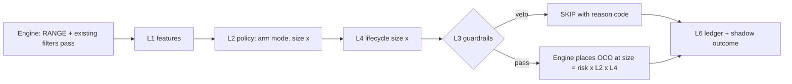

# CycleORB AI OS — Roadmap and Implementation Phases

**Version:** 0.1 (2026-11-05)  
**Engine:** CycleORB v1.09 (production presets, frozen)  
**Inputs:** `doc/genericAIOS.md` (brief), `doc/edge_framework.md` (baselines, triggers, overrides CO-01 … CO-22), `doc/CycleORB_System_Profile.md` (engine behaviour, leak evidence)  
**Task IDs:** `AOS-P<phase>-T<nn>`. Execute one task at a time. Each task ends with a test preset and a loose accept/reject.

---

## 0. Ground rules

1. **The engine is frozen.** Range windows, buffers, stops, targets, exit times and regime filters stay exactly as in the production presets. AI OS layers may only **permit, withhold, cancel a pending order, or resize**. They never rewrite an entry or manage an exit (the time exit is where the edge lives).
2. **One decision point.** CycleORB decides once per setup per day, at range end (the `RANGE` line). Every layer acts at that point, plus pending-order cancel up to entry end and the guardrails at any tick.
3. **The n requirement does not apply** (`edge_framework.md` CO-01). Small samples are handled by pooling across assets, by skip precision, and by the forward test, not by event-count gates.
4. **Survival first, then accuracy.** "Accuracy" means the precision of the fires the OS allows: higher mean R per fire *without* lower payoff `R`. A higher `WR` with a lower `E_N` is a failure (payoff trap).
5. **L3 Guardrails outrank every intelligence layer.** No higher layer can override a guardrail.
6. **Two vocabularies, never mixed:** framework **stages** (0–4) score the EA. OS **layers** (L1–L8) are the software around the engine.
7. **Runbook order** holds for every investigation: data → execution → regime → structure.

---

## 1. Architecture

### 1.1 Layer stack

| Layer | Name | Role | Runs where |
| --- | --- | --- | --- |
| **L1** | Perception | Feature tape at range end: structure, regime, events, cross-session context, execution state | EA (`Features.mqh`) |
| **L2** | Policy | Arm mode (both / long / short / none), size multiplier (0 / 0.5 / 1), pending cancel. Rules first, ONNX model later | EA (`Policy.mqh`, `Gate.mqh`) |
| **L3** | Guardrails | Hard limits: heat cap, calendar-leak kill, slippage guard, lot-minimum guard, DD halving, clock refuse | EA (`Guard.mqh`) |
| **L4** | Edge-health observer | W20 / W40 / W80 health vector and lifecycle state from the EA's own ledger → size advice | EA (`Health.mqh`) + Python cross-check |
| **L5** | Adaptation | Monthly and trigger-based retraining of L2 thresholds and models, champion/challenger, versioned | Python (`tools/aos_*`) |
| **L6** | Memory / ledger | Per setup-day decision row + per event outcome + shadow outcome of withheld events, with reason codes | EA (`Ledger.mqh`) → CSV |
| **L7** | Portfolio / correlation | Bucket throttle (DE40 + UK100), concurrent heat across charts | EA (globals) + Python replay |
| **L8** | Promotion queue | Human approval of every gate or model before it goes live | Doc + review checklist |

### 1.2 Decision pipeline (at range end)



Final size = engine risk × L2 multiplier × L4 multiplier, then clipped by L3. If the clipped size is below the broker minimum, the side is skipped and logged (sizing leak L6, CO-08).

### 1.3 Code layout (modular, one job per file)

```
Experts/CycleORB/
  Include/
    Ledger.mqh     L6  CSV writer: decision rows, event outcomes, shadow tracker
    Features.mqh   L1  feature vector at range end (pure functions, no trading)
    Events.mqh     L1  static event / holiday calendar loader (CSV, tester_file)
    Policy.mqh     L2  deterministic rules -> {armMode, sizeMult, cancelBefore}
    Gate.mqh       L2  ONNX model wrapper (optional, P4+)
    Health.mqh     L4  rolling W20/W40/W80 from the ledger -> lifecycle state, size multiplier
    Guard.mqh      L3  hard vetoes and clips; final authority on size
  tools/           Python: journal/ledger parser, scoring engine, comparison, training, ONNX export
  Presets/AOS/     AOS-P#-T## test presets (full copies of the base preset + changed inputs)
MQL5/Files/        CycleORB_events.csv, ledgers (CORB_<magicBase>_<symbol>_ledger.csv)
```

Every AOS input defaults to **off / no-op**, so the production presets are bit-identical until a task's preset turns a layer on.

### 1.4 Technical choices

| Need | Choice | Why |
| --- | --- | --- |
| Run models inside the EA, in the tester and live | **ONNX** (`OnnxCreateFromBuffer` / `#resource`) | Native in MQL5 and tester-compatible. A Python bridge would not run in the Strategy Tester |
| Event calendar in the tester | Static CSV + `#property tester_file` | The MT5 economic calendar is not available in the tester |
| Cross-chart portfolio state (live) | Terminal global variables `CORB_AOS_HEAT_*` | Already the EA's persistence mechanism |
| Portfolio testing | Python replay of per-asset ledgers merged by time | The tester runs one symbol per pass |
| Skipped-trade outcomes | Shadow tracker: virtual OCO with the engine's exact entry / SL / TP / time exit, simulated on ticks | Measures skip precision live, not just in the tester |

---

## 2. Baseline to beat (AOS-P0 lock)

**Frozen in `tools/aos_baseline.json`** (AOS-P0-T01, 2026-11-06). All rows are CycleORB v1.09 with the production presets, 1000 USD, 2025-07-01 → 2026-10-31 (UK100 from 2025-12-17, where broker history starts). A layer is judged against its asset's own row, using `tools/aos_compare.py` against the run named in `tools/aos_assets.json`.

| Asset | Preset (frozen) | n | E (R) | WR | R | EF / M (pp) | Zone | AL | Worst | Max DD (R) | Fires / 30 d | State | Known leak cell (target) |
| --- | --- | ---: | ---: | ---: | ---: | --- | --- | ---: | ---: | ---: | ---: | --- | --- |
| EURUSD-NY | `EURUSD-6M-NY` | 146 | +0.263 | 47.9 % | 1.66 | +9.3 / 8.0 | **Robust** | 0.95 | −2.40 | 6.0 | 9.4 | Stable | Release-day stop slippage. Narrow ranges |
| EURUSD-LON0700 | `EURUSD-LON0700` | 191 | +0.134 | 49.5 % | 1.33 | +5.3 / 7.0 | Fragile | 0.87 | −1.10 | 15.1 | 12.3 | Expanding | Regime stretches (fold 2 −0.26R). Weakest-cell BM +2.7 pp |
| DE40 | `DE40-6M-FRA-500USD` | 120 | +0.235 | 49.2 % | 1.57 | +9.7 / 8.8 | Robust | 0.90 | −1.41 | 5.4 | 7.7 | **Compressing** | **Long side BM +0.7 pp** |
| JP225 | `JP225-6M-TKY` | 102 | +0.203 | 54.9 % | 1.52 | +14.5 / 9.5 | Robust | 0.53 | −1.03 | 4.1 | 6.4 | Stable | Short side. Last fold +0.04R |
| UK100 | `UK100-6M-LON` | 88 | +0.396 | 52.3 % | 1.82 | +15.7 / 10.2 | Robust | 0.84 | −1.13 | 6.3 | 9.6 | Stable | ρ 0.67 with DE40. Mid-range cell |
| US500 | `US500-6M-NY` | 69 | +0.288 | 56.5 % | 1.53 | +16.0 / 11.4 | Robust | 0.67 | −1.05 | 5.3 | 4.4 | Stable | FOMC / CPI inside the hold. Wide-range cell |
| CTRL-AAPL | `AAPL-6M-NY-RESEARCH` | 81 | −0.084 | 37.0 % | 1.25 | −11.5 / 10.3 | Negative | 0.50 | −1.22 | 12.5 | 5.2 | Below frontier | Control. **15 failed exits** (see the P0 results) |
| CTRL-MSFT | `MSFT-6M-NY-RESEARCH` | 31 | +0.020 | 51.6 % | 1.01 | −2.0 / 16.6 | Negative | 0.57 | −1.27 | 4.1 | 2.2 | n/a | Control (L6 lot-minimum 31 %) |
| CTRL-XOM | `XOM-6M-NY-RESEARCH` | 52 | −0.175 | 24.0 % | 0.51 | −53.2 / 11.3 | Negative | 0.29 | −0.82 | 9.2 | 3.4 | Below frontier | Control (L6 lot-minimum 45 %) |

*Re-frozen 2026-11-06 on **v1.11** with the 2025 holiday dates in the skip lists (AOS-P2 start). US500, AAPL and XOM changed: their 2025 holiday / early-close trades are gone. The other six rows are unchanged, event for event.*

---

## 3. Iteration bar (loose on purpose)

**Accept a layer experiment when all of these hold:**

| Check | Bar |
| --- | --- |
| Expectancy | Pooled `E_N` up, **or** held (± 0.02R) while `AL`, worst event or MaxDD improve |
| **Skip precision** | Withheld events (shadow outcomes): mean R < 0 **and** `BM ≤ 0`. Size-cut events: mean R below the asset's baseline `E` |
| **Fire retention** | ≥ 70 % of the baseline fires per asset (CycleORB already filters 45–65 % of days). < 70 % = `FREQUENCY_STALL` warning, reported |
| Breadth | Improves ≥ 4 of 6 assets, **or** the pooled total, with no asset losing more than 0.05R/event of `E` |
| Health | `EF` (full and W40) ≥ baseline − 1 pp. MaxDD ≤ baseline + 2 pp |
| Negative controls | AAPL / MSFT / XOM stay Negative after costs (`EF ≤ 0`). Raw `E` can sit a hair above 0 (MSFT baseline +0.02R, `EF` −2 pp) |

**Reject immediately when:**

- WR rises but `E_N` or `EF` falls (payoff trap);
- the layer changes the range, stop, target or exit;
- a guardrail would have halted and a higher layer overrode it;
- a negative control turns positive (overfit signal);
- the layer was fitted only on a decay window (DE40 2026-09 → 10, LON0700 2026-01 → 03).

**Promote to live** (AOS-P7 only): `edge_framework.md` R2: ≥ 40 forward events on the OS preset, `E > 0`, `EF > 0` on forward data, `EF > M` on the combined sample, 0 `CALENDAR_LEAK`.

---

## 4. Test presets

Name: `AOS-P{phase}-T{task}_{layer}_{change}_{context}.set`, for example `AOS-P2-T02_L2side_DE40longTrendOnly_FRA.set`.

- Each test preset is a **full copy of the frozen production preset** with only the task's inputs changed. Every input stays listed, because an omitted input keeps the chart's or tester's previous value (v1.07 review, issue 3).
- Header comment: base preset, **changed inputs**, hypothesis, expected skip/fire rate, health fields that must not regress versus the AOS-P0 baseline, and the test window and deposit.
- Stored in `Presets/AOS/`, mirrored to `Profiles/Tester/ORB/AOS/`. Tester `.ini` files go in `tester/aos/`.
- **Since the 2026-11-06 sign-off,** only the approved live set (`AOS-P3-REC_<asset>.set`) stays at the top of both folders. Every research and test preset lives in `archive/` (its `.ini` points to `ORB\AOS\archive\…`).
- Each run is compared with its baseline run **by `event_id`** (magic + local date) using `tools/aos_compare.py`.

---

## 5. Phases

Each phase lists its goal, its tasks and an exit criterion. In the task tables:

- **Health fields** are the edge-framework fields the task should move (↑ up, ↓ down, = hold).
- **Skip / fire** is the expected change in fires versus baseline.

### AOS-P0 — Engine baseline lock and tooling

**Goal:** the numbers to beat and the harness to compare against them. No EA behaviour change.

| ID | Layer | Change | Health fields | Skip / fire | Test preset |
| --- | --- | --- | --- | --- | --- |
| AOS-P0-T01 ✅ | — | Freeze the §2 baseline vectors in `tools/aos_baseline.json` (from `edge_framework.md` §5.2) | — | 0 % | — |
| AOS-P0-T02 ✅ | — | Move the journal parser and scoring engine from the temp scripts into `tools/` (`corb_parse.py`, `corb_bench.py`). The generic framework's §10 fixtures and `edge_framework.md` CO-FX-01…04 are the test suite | — | 0 % | — |
| AOS-P0-T03 ✅ | — | Missing baselines on v1.09: EURUSD-NY, LON0700 (@ 1000 USD) and JP225 over the longest valid window (2025-07 → latest), plus the AAPL / MSFT / XOM negative controls | Fills the §2 rows | 0 % | Production presets unchanged. `.ini` files `tester/aos/AOS-P0-T03_BASE_<asset>.ini` |
| AOS-P0-T04 ✅ | — | `tools/aos_compare.py`: diff two runs by `event_id`. Outputs Δ health vector, skip precision, fire retention, per-asset and pooled | — | — | — |

**Exit:** every asset has a v1.09 baseline row, and the comparison harness reproduces CO-FX-01…04. **Met 2026-11-06.**

#### AOS-P0 results (2026-11-06)

**Delivered:**

- `tools/` contains `corb_parse.py` (journal adapter → `tester/aos/runs/<run_id>/{meta.json, events.csv, decisions.csv}`), `corb_metrics.py`, `corb_bench.py`, `aos_compare.py`, `aos_assets.json` and `aos_baseline.json` (with provenance and per-run `events.csv` SHA-256), plus `tests/`. **26 tests pass:** FX-01…16, CO-FX-01…04, and 6 behaviour tests of the comparison harness (skip precision, payoff trap, engine-change detection, fire-retention warning). See `tools/README.md`.
- 15 run folders parsed: the nine baseline runs (six assets and three controls) plus older v1.08 and 500 USD runs kept for reference.

**Findings:**

1. **No baseline drift (CO-20).** v1.09 reproduces every v1.08 event exactly for EURUSD-NY (95/95) and JP225 (77/77) in 2026. LON0700 at 1000 USD keeps all 124 old events and adds 17 that the 500 USD run skipped for lot size.
2. **EURUSD-NY is now Robust** over 16 months (146 events, `EF` +9.3 > `M` 8.0, `f_max` 1.90 %), so the 1 % preset is no longer `OVER_SIZED` (`edge_framework.md` §8 is updated).
3. **LON0700 is weaker over 16 months:** `E` +0.134R, Fragile, and the pessimistic Kelly comes out at 0, so `f_max` = 0. The preset's 0.5 % is `OVER_SIZED` under CO-13. Its fold 2 (−0.26R) is the stretch AOS-P3-T05 (lifecycle sizing) and AOS-P2-T06 (trend-side gate) target.
4. **JP225 holds over 16 months:** 102 events, +0.203R, `EF` +14.5 > `M` 9.5, `f_max` 4.6 %.
5. **The harness works on real data.** Comparing UK100 @ 1000 (baseline) with UK100 @ 500, where lot-minimum skips act as a withholding layer, gives **REJECT**: the 34 withheld events averaged +0.44R (they were winners), fire retention was 61 %, and WR rose while `E_N` fell (the payoff trap).
6. **New `CALENDAR_LEAK` on a US share (AAPL control).** The research preset exits at 15:55 NY, which falls after the broker's **Friday** share-session end in US standard time. Closes were refused on 2025-11-14, 2025-12-19 and 2026-01-16, and the positions were held over the weekend. A 2025-07-03 early close (before the holiday lists existed) added a fourth hold. The v1.09 backoff limited the log to 5 retries per day. NVDA and TSLA exit at 15:50, which the research says sits before the Friday close; **verify this when their v1.09 baselines are run** (the AOS-P3-T01 kill would catch it live).
7. **The controls stay Negative** (`EF` −12.4 / −2.0 / −51.4 pp). MSFT's raw `E` is +0.02R, so the control rule is `EF ≤ 0`, not `E ≤ 0` (§3 updated).

### AOS-P1 — L6 Ledger and L1 Perception

**Goal:** every setup-day becomes a scored, explainable row. Behaviour stays identical to the baseline (verified by a zero-diff run).

| ID | Layer | Change | Health fields | Skip / fire | Test preset |
| --- | --- | --- | --- | --- | --- |
| AOS-P1-T01 | L6 | `Ledger.mqh`: one **decision row** per setup-day (date, setup, filters, armed sides, lots, risk, reason code), one **event row** per fill (entry/exit fills, slippage, exit type, `pnl_R`, `risk_ccy`, `equity_at_open`). Input `InpAosLedger` (default false). The adapter contract of generic §8, natively | = all (zero-diff) | 0 % | `AOS-P1-T01_L6ledger_on_<asset>.set` |
| AOS-P1-T02 | L6 | **Shadow tracker:** for every withheld or resized side, simulate the engine's exact OCO on ticks (fill, SL, TP, time exit) and log its `pnl_R` as `shadow_R` | Enables skip precision | 0 % | same as T01 |
| AOS-P1-T03 | L1 | `Features.mqh` — existing regime: range/ATR %, H1 vol percentile, D1 trend side, cost %, average versus live spread | = | 0 % | `AOS-P1-T03_L1features_core_<asset>.set` |
| AOS-P1-T04 | L1 | ORB structure: overnight gap / range, range position versus prior-day high/low/close, inside/outside day, NR4/NR7, pre-range drift, distance of the range edges from the D1 SMA in ATR | = | 0 % | `AOS-P1-T04_L1features_structure_<asset>.set` |
| AOS-P1-T05 | L1 | `Events.mqh` + `MQL5/Files/CycleORB_events.csv` (UTC time, currency, event, tier). Tags: release **inside the entry window**, **inside the hold**, holiday, half day, month-end, OPEX / quad witching. `#property tester_file` | = | 0 % | `AOS-P1-T05_L1events_<asset>.set` |
| AOS-P1-T06 | L1 | Cross-session context, read-only: prior US cash-session return and the overnight USDJPY move (for JP225); Asia session return (for DE40/UK100); European session return (for US500/EURUSD-NY); whether the paired index has already broken out today | = | 0 % | `AOS-P1-T06_L1context_<asset>.set` |
| AOS-P1-T07 | L1 / L6 | `tools/aos_tape.py`: join ledger + features + outcomes into the pooled training table. Audit every feature for look-ahead (each value timestamped ≤ range end) | — | — | — |

**Exit:**

- the ledger-on runs are **event-identical** to the baselines (0 diffs) for all six assets;
- shadow outcomes match the baseline outcomes on the same days within 0.02R;
- the pooled tape exists (≈ 525+ events, plus negative controls).

**Met 2026-11-06** (CycleORB v1.10). All seven tasks ✅.

#### AOS-P1 results (2026-11-06)

**As built (deviations from the task table):**

| Task | Built | Notes |
| --- | --- | --- |
| T01 | `Include/Ledger.mqh` | Three CSVs in `Common\Files\CycleORB\` (tester agents can't write to the terminal's own `MQL5\Files`): `CORB_<magicBase>_<symbol>_<tag>_{decisions,events,shadow}.csv`. In the tester, `tag` = `tester_<deposit>[_<InpAosRunTag>]`, truncated each run; live, `tag` = `live`, appended. Exit types come from `DEAL_REASON` (SL / TP / EA → TIME) |
| T02 | `Include/Shadow.mqh` | Shadows **every armed setup-day**, not only withheld sides, so it validates itself against real fills. Same tick rules as the tester (buy stop at ask, sell stop at bid, long exits at bid, short at ask). Sides the engine skipped structurally (price through, TP < SL) are not shadowed; lot-minimum skips are, and appear as `withheld_*` |
| T03–T04 | `Include/Features.mqh` | Decision record `OrbDecision` + 34 feature columns, from bars completed at decision time. The engine's indicator handles and the `SetupTrendSide` / `SetupVolPercentile` helpers moved here from `Setup.mqh` unchanged. With the ledger on, the vol and trend handles are created even when the engine's filters are off; the engine logic still checks its own inputs |
| T05 | `Include/Events.mqh` + `Scripts/CycleORB/CycleORB_ExportCalendar.mq5` | The calendar file is `Common\Files\CycleORB\events.csv`, **exported from the MT5 economic calendar** (1,677 high-impact USD / EUR / GBP / JPY events, 2025-01 → 2027-12, server time = UTC). Run it headless with `tester/aos/export_calendar.ini` (`[StartUp] Script=…`). No `tester_file` needed (Common folder). Holidays stay in `InpSkipDates` |
| T06 | `InpAosCtxSymbols` / `InpAosCtxHours` | Generic: up to 3 context symbols, each with its previous-day move and its move over the last N hours into range start, both in that symbol's D1 ATR. Per-asset choice in the P1 presets (e.g. JP225: SPX500, USDJPY; US500: DE30, UK100). "Paired index already broke out" is deferred to L7 (it needs the other chart's state) |
| T07 | `tools/aos_tape.py` | `collect` (ledgers → run folders), `check` (exit criteria), `build` (pooled tape). The parser appends `InpAosRunTag` to `run_id`, so tagged runs never overwrite baselines |

New inputs (group "AI OS observe", all off by default): `InpAosLedger`, `InpAosRunTag`, `InpAosEventCcy`, `InpAosCtxSymbols`, `InpAosCtxHours`. All 24 production presets now list them (49 inputs), with the ledger off. Test presets: `Presets/AOS/AOS-P1-T06_L6L1_observeAll_<asset>.set` (one cumulative observe-all preset per asset, covering T01–T06); `.ini` files in `tester/aos/`.

**Exit checks** (`python aos_tape.py check --tag P1obs`; v1.10 observe runs against the frozen v1.09 baselines):

| Asset | Events base → obs | Final balance base → obs | Ledger = journal | Shadow within 0.02R | Look-ahead violations |
| --- | --- | --- | --- | --- | --- |
| EURUSD-NY | 146 → 146 | 1439.96 → 1439.96 | yes | 146 / 146 (max diff 0.0) | 0 |
| EURUSD-LON0700 | 191 → 191 | 1116.11 → 1116.11 | yes | 191 / 191 | 0 |
| DE40 | 120 → 120 | 2021.69 → 2021.69 | yes | 120 / 120 | 0 |
| JP225 | 102 → 102 | 1222.24 → 1222.24 | yes | 102 / 102 | 0 |
| UK100 | 88 → 88 | 1285.61 → 1285.61 | yes | 88 / 88 | 0 |
| US500 | 71 → 71 | 1185.96 → **1186.64** | yes | 71 / 71 | 0 |
| CTRL-AAPL / MSFT / XOM | 82 / 31 / 53, identical | identical | yes | 78 / 82, 31 / 31, 53 / 53 | 0 |

**Findings:**

1. **The observe layer changes nothing in the engine.** 8 of 9 runs are bit-identical down to the final balance, and every event's `pnl_R` is identical in all 9.
2. **US500's 0.68 USD difference is a Strategy Tester artifact, fully traced.** Requesting context symbols (DE30, UK100) changes how the tester charges swap over the closed Christmas session on the one multi-day holiday hold (2025-12-24 → 26): −1.71 instead of −3.42. That shifts later capital, and lot rounding flips one trade from 1.1 to 1.2 lots (2026-08-17). A same-day v1.10 run with the ledger off reproduces the baseline exactly (1185.96). Live, the broker charges swap. It also disappears once the 2025 holiday dates are in the skip list (see 5).
3. **The shadow tracker is exact:** 718 / 718 real fills reproduced with 0.0R difference on the six assets. AAPL's 4 mismatches are its Friday weekend holds (the shadow exits at the first quote after 15:55, the engine couldn't), so **shadow − actual measures `CALENDAR_LEAK` directly**.
4. **The tape is ready for P2 / P4:** `tester/aos/tape/tape_P1obs.csv` has 1,431 armed setup-days × 72 columns (decision, 34 features, actual and shadow outcomes). The shadow already gives counterfactuals for lot-minimum days (controls: AAPL 6, MSFT 18, XOM 55 shadow-only fills).
5. **Follow-up (not P1):** the skip-date lists start in 2026, so the 2025 part of every test still trades 2025 US holidays and early closes (US500 2025-07-03 and 2025-12-24). Adding the 2025 dates would make backtests match live behaviour, but changes the US500 and AAPL baselines and has to fit the input-length limit. Decide before P2 scoring.

### AOS-P2 — L2 Policy: deterministic gates first

**Goal:** close the leak cells that are already known, with explainable rules exposed as preset inputs. One rule per task, one asset per preset.

The hook comes first (T01). Each rule then uses `Policy.mqh` inputs such as `InpAosLongGate`, `InpAosShortGate`, `InpAosEventSizeMult`, `InpAosEventTier` and `InpAosCancelBeforeRelease`.

| ID | Layer | Change | Health fields | Skip / fire | Test preset |
| --- | --- | --- | --- | --- | --- |
| AOS-P2-T01 | L2 | Policy hook in `SetupEvaluate`: returns {arm mode, size multiplier, cancel time}. Default = engine behaviour | = (zero-diff) | 0 % | `AOS-P2-T01_L2hook_noop_<asset>.set` |
| AOS-P2-T02 | L2 | **DE40: arm longs only when the D1 close is above SMA20.** Shorts unchanged | BM_worst ↑ (long cell), E ↑, AL ↓, MaxDD ↓ | about −15 to −25 % (long side) | `AOS-P2-T02_L2side_DE40longTrendOnly_FRA.set` |
| AOS-P2-T03 | L2 | **EURUSD-NY: 0.5× size when a tier-1 US release (NFP, CPI, FOMC) falls in the range or entry window** | Worst ↑ (toward −1R), AL ↓, losses < −1.2R ↓, EF ↑ toward M | 0 % skip, about 10 % of fires at 0.5× | `AOS-P2-T03_L2size_tier1Half_EURUSD-NY.set` |
| AOS-P2-T04 | L2 | **US500: 0.5× size (variant B: skip) when FOMC or CPI falls inside the 10:00–15:00 hold** | Worst ↑, AL ↓, MaxDD ↓ | variant A 0 %, variant B about −5 to −10 % | `AOS-P2-T04_L2size_FOMCinHold_US500.set` |
| AOS-P2-T05 | L2 | **JP225: withhold the short side when the prior US cash session closed up more than X × ATR** (X from the P1 tape, chosen on a plateau, not a peak) | Short-cell BM ↑, E ↑ | about −10 to −15 % (shorts) | `AOS-P2-T05_L2side_JP225shortVsUSclose_TKY.set` |
| AOS-P2-T06 | L2 | **LON0700: test the D1 trend-side gate** (the US500 mechanism) | Fold-1 E ↑, rolling-20 minimum ↑, MaxDD ↓ | about −30 to −50 % (one side per day) | `AOS-P2-T06_L2side_trendSide_EURUSD-LON0700.set` |
| AOS-P2-T07 | L2 | **Pending cancel before a tier-1 release inside the entry window** (EURUSD-NY 10:00 ET releases, LON0700 UK 07:00 / 09:30 data) | Losses < −1.2R ↓ | about −3 to −8 % | `AOS-P2-T07_L2cancel_preRelease_<asset>.set` |
| AOS-P2-T08 | L2 | Regime-cell sizing from `edge_framework.md` §5.3: 0.5× in each asset's weakest range/ATR tercile **only if** that cell's shadow and actual BM ≤ +3 pp | AL ↓, E = or ↑ | 0 % skip, about 30 % of fires at 0.5× | `AOS-P2-T08_L2size_weakCell_<asset>.set` |

**Exit:** each accepted rule passes the §3 bar on its asset with skip precision confirmed by shadow outcomes. Rejected rules are recorded with their reason, so they are not retried blindly.

**Completed 2026-11-06** (CycleORB v1.11). T01 ✅. **T02–T07 tested and not accepted. T08 not run** (no cell met its precondition).

#### AOS-P2 results (2026-11-06)

**Preparation (AOS-P2-T00):**

- The 2025-07 → 12 US, UK and DE holiday and early-close dates were added to every skip list, so backtests behave as live would.
- **MT5 truncates string inputs at 255 characters without an error.** The first attempt (260 characters) silently dropped 2027-11-26 and 2027-12-24 (`skip dates=27` instead of 29). v1.11 accepts `YYMMDD` (the US list is now 215 characters with all 29 dates) and logs a WARNING when `InpSkipDates` reaches 250 characters.
- Baselines re-frozen on v1.11 (§2). With the holiday holds gone, **the observe layer is now bit-identical on all 9 symbols**, US500 included (P1 finding 2 resolved).

**Built:** `Include/Policy.mqh` and 10 inputs in the group "AI OS policy L2", all defaulting to the engine's behaviour:

| Inputs | Effect |
| --- | --- |
| `InpAosLongGate`, `InpAosShortGate` | Side gates: off / D1 trend side / context symbol 1's previous-day move (`InpAosCtxGateATR`) |
| `InpAosEventNames`, `InpAosEventWindow`, `InpAosEventSizeMult` | Size multiplier (0–1) on days with a matching high-impact event in the entry or hold window |
| `InpAosCancelBeforeMin` | Cancel pending orders N minutes before a high-impact release after range end and before entry end |
| `InpAosCellAtrMin`, `InpAosCellAtrMax`, `InpAosCellMult` | Size multiplier inside a range/ATR band |

A withheld side is logged as `aos_withhold`, and the shadow tracker keeps simulating it, so every withheld day has its counterfactual. The EA refuses multipliers above 1. All production presets list the new inputs (59 inputs).

**T01 (no-op hook):** v1.11 reproduces the v1.09 baselines to the cent on every asset whose events didn't change (EURUSD-NY 1439.96, LON0700 1116.11, DE40 2021.69, JP225 1222.24, UK100 1285.61). ✅

**Rules** (each variant run against the same asset's v1.11 observe run, ledger-on vs ledger-on, by `event_id`):

| Task | Rule | Fires kept | Withheld or resized days (their baseline R) | E (R) base → variant | Size-weighted Σ R | Max DD (%) | Verdict and reason |
| --- | --- | ---: | --- | --- | --- | --- | --- |
| T02 | DE40 longs only above D1 SMA20 | 78 % | 27 withheld, mean **+0.217R** (BM +10.6 pp) | +0.235 → +0.286 | +28.3 → +26.4 | 13.8 → **16.5** | **Not accepted.** Withholds average trades, not bad ones. DD worse |
| T03 | EURUSD-NY 0.5× on NFP / CPI days | 100 % | 10 resized, mean **+0.282R** (base +0.263) | unchanged | +38.3 → +36.8 | 5.4 → 4.6 | **Not accepted.** Release days are above-average days (the release *is* the edge); −1.5R for −0.8 pp DD |
| T04A | US500 0.5× on FOMC-in-hold days | 100 % | 1 resized, **+1.98R** | unchanged | +19.9 → +19.1 | 4.9 → 4.6 | **Not accepted.** The only FOMC-in-hold trade was a winner |
| T04B | US500 skip FOMC-in-hold days | 99 % | 1 withheld, **+1.98R** | +0.288 → +0.263 | +19.9 → +18.3 | 4.9 → 4.6 | **Not accepted** |
| T05 | JP225 no shorts after a US up-day > 0.5 ATR | 87 % | 13 withheld, mean **+0.427R** | +0.203 → +0.170 | +20.7 → +14.6 | 3.9 → 4.1 | **REJECT** (payoff trap). Contradicted by the P1 tape before the run |
| T06 | LON0700 D1 trend side only | 61 % | 74 withheld, mean **+0.524R**. 23 side-switched days improved (−23.2 → +4.6R) | +0.134 → +0.124 | +25.5 → +14.4 | 5.7 → 4.4 | **Not accepted.** Counter-trend London trades are the *best* ones. `FREQUENCY_STALL` |
| T07a | EURUSD-NY cancel 15 min before releases | 97 % | 4 withheld, mean +0.144R | +0.263 → +0.266 | +38.3 → +37.0 | 5.4 → 5.4 | **Not accepted** (skip precision) |
| T07b | LON0700 cancel 15 min before releases | 97 % | 6 withheld, mean **+0.917R** | +0.134 → +0.108 | +25.5 → +20.0 | 5.7 → 5.7 | **Not accepted** |
| T08 | 0.5× in the weakest range/ATR third | — | — | — | — | — | **Not run.** No asset's weakest third met the ≤ +3 pp precondition on the 16-month data (closest: LON0700 mid +3.8, DE40 mid +3.7) |

Negative controls were not affected (no policy on them).

**Findings:**

1. **No deterministic L2 rule improves the production presets.** In every case the withheld or resized days had **positive** baseline R, usually at or above the asset's average. The presets' own filters (range/ATR band, vol floor, trend side) already remove the bad days; the "leak cells" seen in the P0 tables were in-sample noise that doesn't hold as a skip rule. **The presets stay as they are.**
2. **Release days are where the edge is, not where it leaks.** Halving size on NFP / CPI / FOMC days trades about 1.5R of profit for under 1 pp of drawdown. That is a survival lever to decide at the portfolio level (P3 / P6), not an accuracy gain.
3. **Side gates fail by removing good trades**, though DE40 and LON0700 show the side-switch effect (when the gated side is withheld, the other side's later fill is better on average). Not enough to offset the withheld winners.
4. **The harness worked as designed:** skip precision rejected every rule that removed winners, and it distinguished side switches and compounding drift from engine changes (`aos_compare.py` refinements below).
5. **JP225's reversed pattern** (shorts after a US up-day average +0.43R) was found on the same data, so it is a hypothesis, not a rule. It goes to AOS-P4 as an out-of-sample candidate only.

**Harness refinements** (`tools/aos_compare.py`, 2 new tests, 28 tests pass):

- **Side switches:** same `event_id`, other side filled after the gate withheld the first. Reported separately from engine outcome changes.
- **Policy resizes** are read from the variant ledger's `aos_mult`; lot changes from compounding are reported as "volume drift".
- **Size-weighted Σ R** shows the effect of size-only rules.

**Next:** AOS-P3 (guardrails and lifecycle sizing) needs no prediction and directly targets survival, so it goes ahead. AOS-P4 (learned gate) now has a demonstrated hard bar: the production filters already capture most of what simple rules can see.

### AOS-P3 — L3 Guardrails and L4 Health observer

**Goal:** survival. Hard limits and the lifecycle observer wired to the engine's permission to trade.

| ID | Layer | Change | Health fields | Skip / fire | Test preset |
| --- | --- | --- | --- | --- | --- |
| AOS-P3-T01 | L3 | `Guard.mqh`: **`CALENDAR_LEAK` kill**: a failed exit or an overnight hold blocks new entries on that symbol until manually cleared | Worst ↑, MaxDD ↓ | 0 % (expected; non-zero = a missing skip date) | `AOS-P3-T01_L3calendarKill_<asset>.set` |
| AOS-P3-T02 | L3 | **Fill-slippage guard:** if entry slippage > 0.25R, close at market and log `SLIP_ABORT` (abort only, never re-entry) | Losses < −1.2R ↓ | < 2 % | `AOS-P3-T02_L3slipGuard_<asset>.set` |
| AOS-P3-T03 | L3 | **Lot-minimum guard:** if > 10 % of armed sides are skipped `lot < min` over W40, stop the asset and alert (wrong account size) | L6 sizing leak ↓ | 0 % at the right deposit | `AOS-P3-T03_L3lotGuard_<asset>.set` |
| AOS-P3-T04 | L3 | **DD halving:** 0.5× size at 0.8 × the asset DD limit (`edge_framework.md` §8). Clock mismatch → refuse init live | MaxDD ↓ | 0 % skip | `AOS-P3-T04_L3ddHalve_<asset>.set` |
| AOS-P3-T05 | L4 | `Health.mqh`: W20 / W40 / W80 health vector from the ledger and the lifecycle state per `edge_framework.md` §6.1 (Near frontier 0.5×, Below frontier 0×). Input `InpAosHealthSeed` (baseline E, BWR, Leak) so the tester starts with the validation baseline | Rolling minimum ↑, MaxDD ↓, ΔD visible | Only in bad stretches (DE40 Sep–Oct, LON0700 Feb–Mar) | `AOS-P3-T05_L4lifecycle_<asset>.set` |
| AOS-P3-T06 | L3 / L4 | DE40 sizing per `edge_framework.md` §8: 2 % cap while Compressing, back to 3 % at Stable | MC-2 P95 DD ↓ (23.6 → about 19 %), MC-3 ruin ↓ | 0 % skip (L6 may rise slightly) | `AOS-P3-T06_L3cap2pct_DE40_FRA.set` |
| AOS-P3-T07 | L4 | `tools/aos_health.py`: month-end report of every §6.2 trigger per asset, cross-checked against the EA's `Health.mqh` state | — | — | — |

**Exit:** in replay, the lifecycle state would have flagged DE40 by the end of September 2026 and LON0700 by the end of February 2026, with fire retention ≥ 70 % over the full window.

**Met 2026-11-06** (CycleORB v1.12 / v1.13). DE40 was flagged Compressing at the end of May and Near frontier at the end of August 2026; LON0700 Below frontier at the end of January 2026; LON0700 fire retention with lifecycle sizing 72 %.

#### AOS-P3 results (2026-11-06)

**Built:**

| Module | Content |
| --- | --- |
| `Include/Guard.mqh` (L3) | **Calendar-leak kill:** trips on a close refused with `MARKET_CLOSED`, a position still open 5 minutes after its exit time, or a position carried into a later day; blocks new entries until cleared (live: delete GV `CORB_<magic>_<symbol>_calkill`). **Entry-slippage abort:** closes at market when the fill is more than X R beyond the planned entry; no re-entry that day. **Lot-minimum guard:** stops the asset when more than X % of the last 40 armed sides (minimum 20) hit the lot minimum. **Drawdown halving:** own equity curve (start balance + this EA's closed P&L); 0.5× at 0.8 × limit, restored at 0.5 × limit |
| `Include/Health.mqh` (L4) | W40 / W80 lifecycle from the **shadow stream** (every armed day the engine would have traded), so a halted asset keeps being measured and can recover. Evaluated at each month end; logs `HEALTH <state> …`; writes `health_state` to the decision ledger. Live: rebuilds the stream from the shadow ledger after a restart. Optional sizing (Near 0.5×, Below 0×) and optional risk cap while Compressing or worse |
| `SessionClock.mqh` | `ClockMismatch()`; `InpAosClockRefuse` refuses init live when the server offset is wrong |
| `tools/aos_health.py` (T07) | Month-end replay of W20 / W40 / W80 EF and E, ΔD, state, size and every §6.2 trigger, with the EA's own state alongside (`--ea`) |

Inputs (group "AI OS guardrails L3 / health L4", all off by default): `InpAosCalendarKill`, `InpAosSlipAbortR`, `InpAosLotGuardPct`, `InpAosDdLimitPct`, `InpAosClockRefuse`, `InpAosHealthSizing`, `InpAosHealthBaseE`, `InpAosHealthLeakPP`, `InpAosCompressRiskPct`. All presets list them (68 inputs). L4 sizing requires `InpAosLedger` (validated at init).

v1.13 fixes the calendar-leak detection. In v1.12 it only checked for a tick 5 minutes after the exit; on Friday share closes no such tick arrives, and by Monday the day has rolled. The guard now reacts to the refused close itself and to any position opened on an earlier day.

**Results** (each run against the asset's v1.11 observe run, by `event_id`):

| Task | Run | Effect | Verdict |
| --- | --- | --- | --- |
| T01 calendar kill | 6 production assets | 0 trips (the v1.11 skip lists cover every holiday): identical results | ✅ zero cost |
| | Functional: AAPL control | Trips at the first refused Friday close; 226 later setup-days blocked | ✅ works |
| T02 slip abort 0.25R | EURUSD-NY | 5 aborts (the NFP/CPI stops with 0.25–1.40R entry slippage): those trades −2.15R → −1.03R. AL 0.95 → 0.87, MaxDD 5.4 → 4.7 %, size-weighted Σ R +38.3 → +39.8, +15.9 USD | **ACCEPT** |
| | JP225 | 1 abort (0.51R slippage) that would have been a +1.24R winner: −1.5R, −15.5 USD | Held (AL only slightly better) |
| | DE40, LON0700, UK100, US500 | No entry slipped > 0.25R: identical | — |
| T03 lot guard 10 % | 6 production assets @ 1000 | 0 trips: identical | ✅ zero cost |
| | Functional: UK100 @ 500 | Stopped after 20 armed sides (30 % below the minimum lot) | ✅ works |
| T04 DD halving | 6 assets at their `edge_framework.md` §8 limits | Never reached (all closed DDs < 0.8 × limit): identical | ✅ zero cost (catastrophe guard) |
| | Functional: DE40 at a 12.5 % limit | Halves / restores 3 times; MaxDD 13.8 → 13.4 % for −5.5R | Works, but a drag when tight: **not accepted at tight limits** |
| T05 lifecycle sizing | LON0700 | Below frontier for Feb–May 2026: 54 trades withheld, mean **+0.034R** (≈ zero edge). E +0.134 → +0.173, but MaxDD 5.7 → 6.2 % and −1.7R | **Not accepted** (no survival gain; recovery lag) |
| | DE40 | 7 trades at 0.5× in Sep 2026: −0.7R, MaxDD unchanged to 0.1 pp | Not material, not adopted |
| | EURUSD-NY, JP225, UK100, US500 | Never Near or Below frontier: identical | — |
| T06 DE40 2 % cap while Compressing | DE40 | 39 trades capped (Jun–Oct 2026): **MaxDD 13.8 → 11.2 %** for −0.9R (−46.8 USD, about −2 % of the end balance) | **ACCEPT** |
| T07 health report | DE40 | EA state = replay state for 10 / 10 month ends (one month later, by design) | ✅ |

**Findings:**

1. **The guards are free insurance.** Calendar kill, lot guard and DD halving at the framework limits never fire on the production presets, but they work when their condition occurs (shown on the AAPL control, UK100 @ 500 and a tight DE40 limit).
2. **The slippage abort is the one guard that improves a production asset.** EURUSD-NY's worst losses came from stops filling 0.76R and 1.40R beyond the entry on release spikes; the abort turns them into small losses. The cost is the occasional slipped entry that would have won (2 on EURUSD-NY, 1 on JP225). Pooled over the six assets the effect is about 0R with a smaller tail.
3. **Lifecycle sizing is a monitor, not an auto-pilot.** The observer flags the right periods, but it reacts after the damage and recovers after the rebound. LON0700's halted months were near-zero edge, so halting saved nothing. Keep the observer on (`HEALTH` log, `health_state` in the ledger) for human investigation (L8), with sizing off.
4. **DE40's 2 % cap while Compressing is a genuine survival trade:** −2.6 pp drawdown for under 1R. It matches the `edge_framework.md` §8 recommendation for this small account.

**Recommended set (forward-test candidates, not yet production):** `Presets/AOS/AOS-P3-REC_<asset>.set` = production strategy inputs + ledger observer + calendar kill + 0.25R slippage abort + 10 % lot guard + the asset's DD limit + live clock check, L4 sizing off; DE40 also has the 2 % cap while Compressing. The triggers don't overlap, so the combined backtest effect equals the component results above: EURUSD-NY +1.5R / −0.7 pp DD, JP225 −1.5R, DE40 −0.9R / −2.6 pp DD, the others unchanged. Promotion to live goes through AOS-P7 (forward test).

### AOS-P4 — Avoidance training (L2 learned on labelled engine trades)

**Goal:** find leak cells beyond the known ones. The model only withholds or resizes.

| ID | Layer | Change | Health fields | Skip / fire | Test preset |
| --- | --- | --- | --- | --- | --- |
| AOS-P4-T01 | L2 | Pooled dataset from the P1 tape across all six assets (+ negative controls as a separate check). Features normalised to R / ATR. Asset and session as features | — | — | — |
| AOS-P4-T02 | L2 | Labels: `pnl_R`, `is_SL`, `is_tail` (< −1.2R), `time_exit_R`. Objective: **predicted E per fire**, never WR | — | — | — |
| AOS-P4-T03 | L2 | Model: monotone gradient-boosted trees or logistic regression with few features. **Anchored monthly walk-forward** (train through month t, score month t+1). Report skip precision per fold | E ↑, AL ↓ | Target −10 to −25 % | — |
| AOS-P4-T04 | L2 | Export ONNX. `Gate.mqh` loads it (`InpAosGateModel`, `InpAosGateMode` = off / withhold / size). The model hash is printed in `Init OK` and the ledger | = (zero-diff with mode off) | 0 % (off) | `AOS-P4-T04_L2onnx_off_<asset>.set` |
| AOS-P4-T05 | L2 | Per-asset threshold so fire retention ≥ 70 %. Chosen from a plateau of thresholds, not the peak | E ↑, EF ↑, MaxDD ↓ | −10 to −30 % | `AOS-P4-T05_L2onnx_withhold_<asset>.set` |
| AOS-P4-T06 | L2 | Size-mode variant: 0.5× instead of withhold below the threshold | AL ↓, MaxDD ↓, E = | 0 % skip | `AOS-P4-T06_L2onnx_size_<asset>.set` |
| AOS-P4-T07 | L2 | **Negative-control check:** run the gate on AAPL / MSFT / XOM. They must stay `E ≤ 0` | Controls = | — | `AOS-P4-T07_L2onnx_control_<symbol>.set` |

**Exit:** the model beats the best P2 rule set on pooled `E_N`, or holds it with lower AL / MaxDD, with confirmed skip precision and controls still negative. If not, the P2 rules remain the production policy and the model is shelved. That is an acceptable outcome.

**Completed 2026-11-06: model SHELVED.** T01–T03 and T05–T07 evaluated offline; **T04 (ONNX + `Gate.mqh`) deliberately not built**, because a model that fails out of sample does not justify EA complexity.

#### AOS-P4 results (2026-11-06)

**Setup** (`tools/aos_gate_wf.py`; results in `tester/aos/p4_walkforward*.json`):

| Item | Choice |
| --- | --- |
| Data (T01) | `tape_P1obs.csv` (v1.11): 959 filled armed days, of which 716 on the six assets and 243 on the controls; 2025-07 → 2026-10 |
| Label (T02) | `shadow_R`, the engine's exact outcome per armed day (P1: 0.0R difference from real fills). Objective = predicted R per fire, never WR |
| Features | 26 decision-time L1 features (regime, ORB structure, calendar, cross-session context, spread ratio), with range/ATR, cost and spread z-scored **per asset on the training data only**, plus asset and session one-hot |
| Models (T03) | Ridge regression (α 30) and a shallow gradient-boosted tree (depth 2, 150 iterations, minimum leaf 30) |
| Walk-forward | Anchored monthly: train on every month before *t* (≥ 250 events), score month *t*. Out-of-sample months 2026-02 → 2026-10: 462 asset events, 149 control events |
| Gate (T05) | Withhold a day when its prediction is below the asset's in-sample 30th percentile (target 70 % retention); variant at 90 % |
| Size mode (T06) | The same days at 0.5× instead of withheld |
| Controls (T07) | AAPL / MSFT / XOM never trained on; scored with the pooled threshold |
| Benchmark | The same number of days withheld at random (2,000 draws): `p_rand` = the share of random draws whose withheld mean is at or below the model's |

**Out-of-sample results (pooled, six assets):**

| Model | Retention | E all → kept | Withheld days: mean R | `p_rand` | Σ R all → kept → 0.5× size | Skip precision |
| --- | --- | --- | --- | --- | --- | --- |
| Ridge, 70 % | 62 % | +0.252 → +0.210 | **+0.321** | 0.81 | +116.5 → +60.0 → +88.3 | ✗ |
| Tree, 70 % | 66 % | +0.252 → +0.237 | **+0.283** | 0.65 | +116.5 → +71.9 → +94.2 | ✗ |
| Ridge, 90 % | 83 % | +0.252 → +0.238 | **+0.322** | 0.72 | +116.5 → +91.1 → +103.8 | ✗ |
| Tree, 90 % | 86 % | +0.252 → +0.244 | **+0.303** | 0.66 | +116.5 → +97.5 → +107.0 | ✗ |

**Findings:**

1. **The learned gate anti-selects out of sample.** In every configuration the days it withheld were *better* than the average day (+0.28 to +0.32R against +0.25R), worse than skipping at random. Every variant, including the 0.5× size mode, lowers Σ R. The exit criterion is not met: **the model is shelved and the engine stays ungated** (P2 also produced no rule).
2. **The per-asset "passes" are noise.** Some single cells pass (tree DE40 at 70 %, −0.14R withheld, p 0.15; ridge EURUSD-NY at 90 %, −0.38R withheld on 12 days, p 0.03), but they are not significant after 12 asset × model tests and the other model disagrees each time (e.g. tree EURUSD-NY at 90 %: +0.99R withheld).
3. **The controls stay negative** under the gate (EF ≤ 0), so the pipeline doesn't manufacture edge, but it has nothing to add either.
4. **JP225 hypothesis from P2:** shorts after a US up-day > 0.5 ATR averaged +0.46R (n 5) in 2025-07 → 2026-02 and +0.41R (n 8) in 2026-03 → 10. The direction is consistent, but the actionable rule (withhold the *other* shorts) fails skip precision in the second half (+0.07R withheld). **Not a rule;** it goes to the P7 forward-test ledger as a watch item.
5. **Combined conclusion from P2 + P4: there is no exploitable conditional leak in the production presets at this sample size.** The regime filters already remove what deterministic rules and a pooled model can see. The AI OS adds value through **survival** (P3 guards, slippage abort, DE40 compress cap) and **monitoring** (ledger, shadow, health), not through trade selection.

**Next:**

- **AOS-P5 (retrain loop)** has nothing to retrain. **Defer it** until the forward ledger supplies at least 6 more months of out-of-sample data, then re-run `aos_gate_wf.py` on the larger tape (same frozen protocol).
- **AOS-P6 / P7** proceed with the `AOS-P3-REC` presets: portfolio heat cap and correlation throttle (P6), then the demo forward test (P7).

### AOS-P5 — L5 Retrain loop

**Goal:** keep L2 adapted without overfitting to the decay window.

| ID | Layer | Change | Health fields | Skip / fire | Test preset |
| --- | --- | --- | --- | --- | --- |
| AOS-P5-T01 | L5 | Monthly cadence script: rebuild the tape → retrain the challenger → score both on the last 3 months out-of-sample | — | — | — |
| AOS-P5-T02 | L5 | **Champion / challenger:** the challenger replaces the champion only if W40 `EF` ≥ the champion's and MaxDD is not worse, on the same out-of-sample months | EF =/↑ | — | `AOS-P5-T02_L5challenger_<asset>.set` |
| AOS-P5-T03 | L5 | **Trigger retrain** on Compressing or Near frontier (L4), with a decay-window guard: the training data must include ≥ 6 months before the decay started | — | — | — |
| AOS-P5-T04 | L5 | Model registry: version, hash, training window, features, thresholds, metrics, approval. No silent overwrite. The EA refuses an unregistered hash live | — | — | — |
| AOS-P5-T05 | L5 | Rollback rule: if live W20 shadow skip precision turns positive (withheld fires winning) for 2 months, revert to the previous champion or the P2 rules | Skip precision | — | — |

**Exit:** two consecutive monthly cycles run end to end, with the registry, approval and rollback exercised once.

### AOS-P6 — Full-stack integration, L7 portfolio and named presets

**Goal:** the whole stack per asset, plus a portfolio view.

| ID | Layer | Change | Health fields | Skip / fire | Test preset |
| --- | --- | --- | --- | --- | --- |
| AOS-P6-T01 | L7 | **Correlation throttle (Europe-open bucket):** if DE40 is already filled, UK100 the same morning arms at 0.5× (variant B: only the opposite side) | Portfolio P95 DD ↓ | UK100 0 % skip, about 40 % of fires at 0.5× | `AOS-P6-T01_L7bucket_EUopen_UK100.set` |
| AOS-P6-T02 | L3 / L7 | **Portfolio heat cap:** concurrent risk ≤ 3 % across charts (global variables). Python replay of merged ledgers for testing | Portfolio MaxDD ↓ | < 5 % | `AOS-P6-T02_L3heatCap3_<asset>.set` |
| AOS-P6-T03 | L1 / L2 | Session-quality score (tick density, spread stability, holiday-thin flags) at range end. Withhold below the floor | Losses < −1.2R ↓ | < 3 % | `AOS-P6-T03_L1sessionQuality_<asset>.set` |
| AOS-P6-T04 | all | **Full-stack presets per asset:** accepted P2–P4 layers + L3 + L4 + L6 on, e.g. `AOS-P6-T04_FULL_DE40_FRA.set` | All §2 fields versus baseline | per accepted layers | `AOS-P6-T04_FULL_<asset>.set` |
| AOS-P6-T05 | all | **Portfolio replay** of the six full-stack ledgers merged by time: G4′ MC-2 / MC-3 on the merged stream, bucket correlations, heat-cap hits | Portfolio P95 DD ≤ 25 %, ruin ≤ 1 % | — | — |
| AOS-P6-T06 | L8 | Promotion queue template: one page per candidate (changes, health deltas, skip precision, controls, risks). Human sign-off required | — | — | — |

**Exit:** each asset has one FULL preset that passes the §3 bar against its baseline, and the portfolio replay is inside the DD mandate.

**Met 2026-11-06.** No EA change in P6. The full stack per asset is `AOS-P3-REC_<asset>.set`, and the six-asset portfolio replay is inside the 25 % DD mandate (MC-2 P95 23.9 %). Retraining (AOS-P5) is deferred, as agreed.

#### AOS-P6 results (2026-11-06)

**Built:**

- `tools/aos_portfolio.py` (T05) with `tools/aos_portfolio_streams.json`: replays the six `AOS-P3-REC`-equivalent tester streams on one account, merged by time.
  - Each armed setup-day reserves its risk from arming until its exit (or entry end), as an EA-side terminal-wide reservation would.
  - Simulated rules: heat cap, and the Europe-open bucket throttle (second same-direction DE40 / UK100 fill halved or withheld).
  - Reported: compounded return, MaxDD, MC-2 block bootstrap (block 10), daily-R correlations.
- `doc/aos_promotion_queue.md` (T06): the L8 template, with candidate 1 (`AOS-P3-REC`, v1.13) filled in and awaiting sign-off.

The Strategy Tester runs one symbol at a time, so cross-chart rules can only be judged by this replay.

**Portfolio replay** (six assets, 2025-07 → 2026-10, 860 armed setup-days, 716 fills; each trade at its own run's effective risk):

| Variant | Ending equity (×) | Ann. | MaxDD | Return / DD | MC-2 P95 DD | MC-2 P5 terminal | Trades resized |
| --- | ---: | ---: | ---: | ---: | ---: | ---: | ---: |
| **No portfolio rule (`AOS-P3-REC`)** | **5.92** | 282 % | 14.2 % | **34.6** | **23.9 %** | 2.93 | — |
| Heat cap 2 % | 3.72 | 169 % | 9.1 % | 29.9 | 19.1 % | 2.17 | 184 |
| Heat cap 3 % | 5.17 | 245 % | 13.0 % | 32.1 | 23.6 % | 2.63 | 75 |
| Heat cap 4 % | 5.80 | 276 % | 14.2 % | 33.7 | 24.1 % | 2.88 | 10 |
| Europe bucket, second fill 0.5× | 5.12 | 242 % | 13.1 % | 31.3 | 23.4 % | 2.67 | 38 |
| Europe bucket, second fill skipped | 4.40 | 205 % | 12.0 % | 28.2 | 23.3 % | 2.37 | 38 |
| Heat cap 3 % + bucket 0.5× | 4.53 | 212 % | 12.4 % | 28.4 | 23.3 % | 2.41 | 113 |

The ending equity and annualised figures compound six edges on one account at each asset's own risk. Read them for **relative** comparison, not as an expected return.

**Concentration:** reserved risk at arming has a median of 1.0 %, P95 3.6 % and maximum 5.7 %. The most risk open at once was 5.7 %; the worst portfolio day was −4.6 % (2026-05-22). Daily-R correlation: **DE40–UK100 +0.70** (52 shared days); every other pair is between −0.15 and +0.31.

**Session quality (T03), offline:** the live / range-window spread ratio carries no signal. The widest-spread fifth of days averaged +0.28R, the same as the tightest fifth; only UK100's is slightly negative (−0.06R). **Not built.**

**Findings:**

1. **No portfolio rule improves risk-adjusted outcome.** The heat cap and the bucket throttle only cut exposure, lowering return faster than drawdown. Scaling every asset's risk down does the same job more simply. **T01 (bucket throttle) and T02 (heat cap) are not built.**
2. **DE40 and UK100 really are one correlated bet** (ρ +0.70), but each keeps a positive edge on the days both fill, so throttling the second fill costs more than the variance it removes.
3. **The recommended set is already inside the portfolio mandate:** MC-2 P95 DD 23.9 % ≤ 25 %, P(ruin) 0, worst day −4.6 %, peak open risk 5.7 %. **Portfolio risk is controlled through each asset's risk input**, and the replay must be re-run whenever an asset is added (e.g. NVDA / TSLA) or a risk input changes.
4. **The full stack (T04) equals `AOS-P3-REC`.** No P2, P4 or P6 layer was accepted, so there are no separate FULL presets.
5. **Next: AOS-P7.** Sign off candidate 1 in `doc/aos_promotion_queue.md`, then run the demo forward test with the `AOS-P3-REC` presets under the stop and promotion rules written there.

### AOS-P7 — Live promotion

**Goal:** the only phase that uses the full framework gates. One OS candidate per asset against its engine-only baseline.

| ID | Layer | Change | Health fields | Skip / fire | Test preset |
| --- | --- | --- | --- | --- | --- |
| AOS-P7-T01 | all | **Demo forward test** of the FULL presets (frozen) with the ledger and shadow tracker. The engine-only counterfactual comes from the shadow outcomes, so no second account is needed | Forward health vector | per FULL | `AOS-P7-T01_FWD_<asset>.set` |
| AOS-P7-T02 | — | R2 check per asset (`edge_framework.md` §7): ≥ 40 forward events, `E > 0`, forward `EF > 0`, combined `EF > M`, MC-3 median ≥ `C_0`, 0 `CALENDAR_LEAK` | — | — | — |
| AOS-P7-T03 | all | Live at `f ≤ f_max` (`edge_framework.md` §8), heat cap on, L8 sign-off | — | — | `AOS-P7-T03_LIVE_<asset>.set` |
| AOS-P7-T04 | — | R3 scale review after 100 forward events with `EF > M` on forward data alone | — | — | — |

**Exit:** each promoted asset runs live with the full stack and monthly L4/L5 cycles.

---

## 6. Order of work and quick wins

| Order | Task | Why first |
| --- | --- | --- |
| 1 | AOS-P0-T02 + T04 | Tooling. Every later decision depends on the comparison harness |
| 2 | AOS-P1-T01 + T02 | Ledger and shadow outcomes. Skip precision cannot be measured without them |
| 3 | AOS-P3-T05 | L4 lifecycle sizing: rules already specified, the largest survival gain |
| 4 | AOS-P2-T02 | DE40 long-side gate: the largest known leak cell |
| 5 | AOS-P2-T03 / T04 | Release-day size cuts: remove the −2.4R tail |
| 6 | AOS-P6-T01 / T02 | Portfolio survival once several presets run |
| 7 | AOS-P4 | ML only after the deterministic layers are scored |

---

## 7. Out of scope

- Re-optimising range windows, RR, stops, buffers, exit times or regime filters (edge discovery is closed for these presets).
- Trailing stops, break-even moves, partial exits, re-entries (ROADMAP §7; the time exit is the edge).
- New entry models or new instruments.
- Size multipliers above 1× before AOS-P7 R3.

## 8. Risks and caveats

- **Small per-asset samples.** Rules can fit noise. Mitigations: pooled evaluation, plateau thresholds, shadow skip precision, negative controls, forward test.
- **The skip trap.** Withholding raises WR easily. Only `E_N`, AL, MaxDD and skip precision count.
- **The event calendar is static.** Release times shift (DST, rescheduled FOMC). Re-check the CSV monthly, and treat a missing tag as a P3 investigation.
- **Tester ≠ live for the context features** (cross-symbol data in the tester needs those symbols' history loaded). Verify each L1 feature in the tester against live values during the P7 demo.
- **Lot granularity** at 500–1000 USD turns 0.5× multipliers into skips on DE40 and UK100. Track the L6 sizing leak for every size task.
