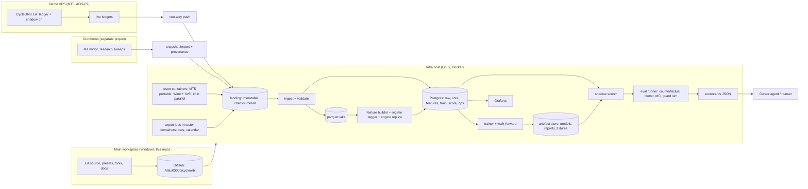

# CycleORB Infra Scale-up — Roadmap and Implementation Phases

**Version:** 0.1 (2026-11-06)  
**Engine:** CycleORB v1.13. Production presets are frozen. The `AOS-P3-REC_<asset>` guard set is signed off for the demo forward test (`doc/aos_promotion_queue.md`)  
**Brief:** `doc/genericubfra.md`  
**Inputs:** `doc/CycleORB_System_Profile.md` (the brief's "system design"), `doc/edge_framework.md` (baselines, CO-01 … CO-22), `doc/unified_edge_framework.md` (generic §8 adapter contract, FX-01…16), `doc/ai_OS.md` (layers L1–L8, AOS-P0 … P7 results)  
**Task IDs:** `INF-P<phase>-T<nn>`. Execute one task at a time. Each task ends with a **replay / eval recipe**, not a live preset.

**Topology (decided 2026-11-06):**

| Role | Where | Notes |
| --- | --- | --- |
| **Main workspace** | This folder, repo [github.com/Atlas00000/cycleorb](https://github.com/Atlas00000/cycleorb) | EA source, tools, docs, presets, evidence. Compile in MetaEditor here |
| **Demo forward test** | A VPS running MT5 | Outside this workstream (AOS-P7). It only **pushes** its ledgers to the infra |
| **Servers, services and the tester** | Docker containers on the infra host | Postgres, MinIO, Grafana, jobs, **and headless MT5 tester containers** |
| **Ouroboros** | Separate project and workspace | A data source only. We import the slices we need and keep them here, with provenance. No runtime dependency |

---

## 0. Ground rules

1. **Offline, then shadow, then wiring.** INF-P0 … P6 never change EA logic and never produce a live `.set`. Wiring is INF-P7 (design only) and INF-P8.
2. **Do not reopen edge discovery.** No re-optimising of ranges, buffers, stops, targets, exit times or regime filters (`ai_OS.md` §7). The "edge discovery" inputs are `edge_framework.md` §5.3 (regime cells, `BM_worst`), System Profile §3–§7, and the AOS-P2 / P4 results. No separate `Edge Discovery.md` exists.
3. **Protect, don't overfilter.** The default is to allow. A skip has to be earned. When unsure, fire and log. Skip thresholds are pre-registered (§8.2) and may not be tightened during INF phases to "look more selective".
4. **Three vocabularies, never mixed.** Framework **stages** (0–4) are how we score. AI OS **layers** (L1–L8) are what will eventually sit on the engine. Infra **planes** (P-DATA … P-ACCESS) are what we build now.
5. **Every tool names the limitation it removes** (§2). A component with no `L-xx` row is not built.
6. **Intelligence never rewrites entries.** It only permits or withholds, and only in shadow until INF-P7. L3 guardrails may be *simulated* in the eval harness, where they outrank every model.
7. **Framework numbers on every eval:** `WR, R, BWR, BM, Leak, EF, M, E_N, ΔD, MaxDD`, skip rate, and fire count versus baseline. Never "AI confidence".
8. **Runbook order** for any surprise: data → execution → regime → structure.

### 0.1 How this plan binds the generic brief (`IB-xx`)

The brief is written for a generic EA. Where it doesn't fit CycleORB, this document overrides it, in the same way `edge_framework.md` overrides the generic framework.

| # | Brief says | Issue for CycleORB | Resolution here |
| --- | --- | --- | --- |
| **IB-01** | Read `system design.md`, `Edge Discovery.md` | Neither file exists | System design = `CycleORB_System_Profile.md`. Edge discovery = `edge_framework.md` §5.3 + `ai_OS.md` AOS-P2 / P4 |
| **IB-02** | Accept on `W250` EF / MaxDD; `n remaining ≥ 100`, warn < 385 | Each asset has 69–191 events in total. W250 does not exist per asset (CO-01, CO-02) | **Pooled** across the six assets: W250, `n ≥ 100`, warn < 385. **Per asset:** W40 / W80 and the full sample, using `edge_framework.md` §6.1 |
| **IB-03** | Skip when `BM_cell ≤ 0` | No qualifying cell (n ≥ 15) is ≤ 0 on the production presets (lowest: DE40 long +0.7 pp) | The cell rule is kept. **Today it yields 0 skips, and that is the expected, correct outcome** (§4) |
| **IB-04** | "Train offline, then prove improvement" | AOS-P2 (rules) and AOS-P4 (learned gate) were already run and rejected out of sample. Retraining the same 716 fills will reproduce that verdict | The infra must **add independent evidence** (validated engine replica on longer history, forward ledgers when they exist) or it is plumbing only. INF-P4-T07 states this as a test |
| **IB-05** | "No forward testing for now" | The AOS-P7 demo forward test was signed off on 2026-11-06 | The forward test runs **on a VPS, outside** this workstream. The VPS pushes its live ledgers, which are ingested **read-only** as `kind=live` data, never as a baseline (INF-P2-T07) |
| **IB-06** | "Tester stays on the trading box" | The observed blocker is that the tester **can't run while live experts are attached** to the same terminal (ROADMAP P1-T09 … T11) | The tester runs in **Docker containers** (portable MT5 under Wine + Xvfb), several in parallel, gated by parity against the native Windows tester. Until parity passes, a native portable terminal is the reference (INF-P2-T04) |
| **IB-07** | Build golden FX fixtures | FX-01…16 and CO-FX-01…04 already pass (28 tests, `tools/tests`) | P-TEST **extends** the existing suite. It is not rebuilt |
| **IB-08** | Postgres, Docker, dedicated box | Data volume is tiny: about 5 MB of ledgers and 69 MB of journals | These are justified by **lineage, a model registry, reproducibility and agent access**, not by scale. §5.2 names the limit each one removes |
| **IB-09** | "AOS-P0 / engine baseline" | Two candidate baselines exist | **Primary:** the engine-only `tools/aos_baseline.json` (v1.11 production presets). **Secondary:** `AOS-P3-REC` (v1.13 guards), reported alongside (§3) |

---

## 1. Where we start

| Item | State (2026-11-06) |
| --- | --- |
| EA | `CycleORB.mq5` + 12 includes. The observe layer (`Ledger`, `Shadow`, `Features`, `Events`), the L2 hook (`Policy`), L3 (`Guard`) and L4 (`Health`) are all off by default. 68 inputs per preset |
| EA output | Journal print lines (`RANGE`, `SKIP`, `PLACE`, deals, `CYCLE_END`, `HEALTH`). With `InpAosLedger=true`, three CSVs per run in `Common\Files\CycleORB\` (`decisions`, `events`, `shadow`): 106 files, about 5 MB |
| Run store | `tester/aos/runs/<run_id>/` (`meta.json`, `events.csv`, `decisions.csv`, `ledger_*.csv`): about 60 run folders, with v1.10 / v1.11 copies duplicated byte for byte |
| Tape | `tester/aos/tape/tape_P1obs.csv`: 1,431 armed setup-days × 72 columns. 716 fills on six assets plus 243 on the controls |
| Python | `tools/`: `corb_parse`, `corb_metrics`, `corb_bench`, `aos_compare`, `aos_tape`, `aos_health`, `aos_gate_wf`, `aos_portfolio`. Mostly stdlib, plus numpy / pandas / sklearn for `aos_gate_wf`. 28 tests |
| Scorecards | Loose JSONs: `tester/aos/p1_check.json`, `p2_compare.json`, `p3_*.json`, `p4_walkforward*.json`, `p6_portfolio.json` |
| Version control | Own repo since 2026-11-06 ([Atlas00000/cycleorb](https://github.com/Atlas00000/cycleorb)), nested inside the untracked `Experts/CycleORB/` of the `MQL5/` repo |
| Machine | Windows, 12 logical CPUs, 24 GB RAM, Python 3.12.10, Docker 29.4 |
| History | YWO real ticks from 2025-06-18. Older broker history is stamped in a different time zone, with a different spread (ROADMAP P1-T08, T11) |

---

## 2. Limitation map

Each row names a current limit, the plane that removes it, and the first task that does so. "Tester" means the MT5 Strategy Tester. "EA" means CycleORB as built.

| ID | Limitation | Evidence | Consequence | Plane | Task |
| --- | --- | --- | --- | --- | --- |
| L-01 | EA, tools, docs and presets are not under version control | `git status`: `?? Experts/CycleORB/` | No reproducible "code at eval time". Model and eval lineage can't cite a commit | P-ACCESS | INF-P0-T01 |
| L-02 | Tester runs one symbol per pass | `ai_OS.md` P6 | Cross-chart rules (heat cap, bucket) can only be judged by a Python replay | P-TRAIN | INF-P4-T01 |
| L-03 | The tester can't run while live experts are attached to the terminal | ROADMAP P1-T09 / T10 / T11 ("terminal had live experts") | Research stalls whenever the account trades | P-BOX | INF-P2-T04 |
| L-04 | Tester runs are launched by hand (UI or one `.ini` at a time). No queue, no run registry | `tester/aos/*.ini` | Slow, error-prone batches. Nothing records which ini produced which folder | P-DATA / P-BOX | INF-P2-T04 |
| L-05 | Real-tick history starts 2025-06-18. Older history has a different TZ stamp and spread | System Profile §13, ROADMAP | 69–191 events per asset. **This is the binding constraint on everything AI** | P-FEAT | INF-P3-T07 |
| L-06 | Pre-v1.10 runs exist only as journals. The parser is coupled to log strings | `tools/README.md` limits | A log-message change silently breaks the adapter | P-DATA | INF-P1-T01, INF-P2-T03 |
| L-07 | Ledgers live in `Common\Files`, are truncated on each tester run, and are appended live. No central copy | `ai_OS.md` P1 T01 | Re-running a tag overwrites evidence. Live and tester data sit side by side with no guard | P-DATA | INF-P1-T05, INF-P2-T01 |
| L-08 | Run folders are plain files: duplicates and no content dedupe. Lineage is only `meta.json.source` | v1.10 / v1.11 identical copies | Can't tell whether two results are the same evidence | P-STORE | INF-P1-T03 |
| L-09 | No system of record. No query across runs, versions or assets | Scorecards are separate JSONs | Every new question needs a new script | P-STORE | INF-P1-T02 |
| L-10 | Generic §8 fields are missing (`leg_id`, `pnl_gross_ccy`, `cost_*_ccy`, `exit_requested`). Currency P&L is estimated with one conversion factor per run | `events.csv`, `meta.json.usd_per_price_lot` | The adapter contract is only partly met. Cost components are implicit | P-DATA | INF-P1-T01, INF-P2-T02 |
| L-11 | Features are computed only inside the EA during a tester pass | `Features.mqh` | Each new feature costs a 9-symbol tester re-run. No offline experimentation | P-FEAT | INF-P3-T03 |
| L-12 | No bar store outside MT5 | — | Regime tagging, replica and feature work can't run on the box | P-FEAT | INF-P3-T02 |
| L-13 | The MT5 economic calendar is unavailable in the tester. The exported CSV is overwritten in place, with no snapshot version | `ai_OS.md` P1 T05 | Release-time changes rewrite history silently | P-FEAT | INF-P3-T02 |
| L-14 | MT5 truncates string inputs at 255 characters without an error | `ai_OS.md` P2 T00 (skip dates) | A preset can silently drop holidays | P-TEST | INF-P5-T07 |
| L-15 | An input omitted from a `.set` keeps the previous value | v1.07 review, issue 3 | Silent preset drift | P-TEST | INF-P5-T07 |
| L-16 | Indicator warm-up (500 H1 bars). The first weeks of a window are lost | System Profile N4 | Windows aren't comparable unless warm-up days are flagged | P-DATA | INF-P2-T06 |
| L-17 | Tester artifacts: swap changes when context symbols are requested (US500 0.68 USD) | `ai_OS.md` P1 finding 2 | Bit-identity tests need tolerance classes | P-TEST | INF-P5-T07 |
| L-18 | No Monte Carlo, bootstrap or walk-forward in the tester | — | Already compensated in Python. Single-threaded, fixed seed, ±0.5 pp seed noise | P-TRAIN / P-BOX | INF-P4-T02, INF-P5-T05 |
| L-19 | A Python bridge does not run in the tester. In-EA models must be ONNX | `ai_OS.md` §1.4 | Every model needs an ONNX export path and a parity check before wiring | P-TRAIN | INF-P7-T03 |
| L-20 | No model registry. P4 results are JSON files, and models are not persisted | `p4_walkforward*.json` | Champion/challenger and rollback are impossible | P-TRAIN | INF-P4-T04 |
| L-21 | Logs are print statements with no correlation ids. Journals reach 16–69 MB | System Profile N2 | The agent greps megabytes to answer "why was this day skipped?" | P-OBS | INF-P5-T01 |
| L-22 | No single scorecard. The agent must know which of seven JSONs is current | `tester/aos/*.json` | Wrong-file answers. Slow onboarding | P-ACCESS | INF-P5-T08 |
| L-23 | Python dependencies are unpinned | `aos_gate_wf.py` needs numpy / pandas / sklearn | Results can drift between machines | P-PACK | INF-P5-T04 |
| L-24 | Comparisons are valid only at the same deposit (lot minimum) | CO-FX-03, CO-08 | Cross-deposit comparisons give a false verdict | P-STORE / P-TRAIN | INF-P1-T03, INF-P4-T01 |
| L-25 | Holiday lists are static and end 2027-12-31 | `edge_framework.md` §11.1 | `CALENDAR_LEAK` returns silently in 2028 | P-OBS | INF-P5-T02 |
| L-26 | Ouroboros (the M1 mirror and research sweeps used for longer windows) is a separate project and workspace | ROADMAP P1 reviews cite `Ouroboros/research/...` | The longest history source isn't in this workspace and has no provenance here | P-DATA | INF-P0-T04 |

---

## 3. Baseline to protect (locked in INF-P0-T03)

The **primary** baseline is the engine only: `tools/aos_baseline.json`, v1.11 production presets, 1000 USD, 2025-07-01 → 2026-10-31 (UK100 from 2025-12-17). The **secondary** baseline is the `AOS-P3-REC` stack (v1.13), reported alongside. The tape `tape_P1obs.csv` is the labelled source for every offline model.

| Asset | n | E (R) | EF / M (pp) | MaxDD % at `f` | Fires / 90 d | Warn < 70 % | `FREQUENCY_STALL` < 50 % | `AOS-P3-REC` delta |
| --- | ---: | ---: | --- | ---: | ---: | ---: | ---: | --- |
| EURUSD-NY | 146 | +0.263 | +9.3 / 8.0 | 5.4 | 28.2 | 19.7 | 14.1 | E +0.270, MaxDD 4.7 |
| EURUSD-LON0700 | 191 | +0.134 | +5.3 / 7.0 | 5.7 | 36.9 | 25.8 | 18.5 | identical |
| DE40 | 120 | +0.235 | +9.7 / 8.8 | 13.8 | 23.1 | 16.2 | 11.6 | MaxDD 11.2 |
| JP225 | 102 | +0.203 | +14.5 / 9.5 | 3.9 | 19.2 | 13.4 | 9.6 | E +0.190 |
| UK100 | 88 | +0.396 | +15.7 / 10.2 | 5.2 | 28.8 | 20.2 | 14.4 | identical |
| US500 | 69 | +0.288 | +16.0 / 11.4 | 4.9 | 13.2 | 9.2 | 6.6 | identical |
| **Pooled (six)** | **716** | recomputed in T03 | recomputed in T03 | recomputed in T03 | — | — | — | Portfolio replay MaxDD 14.2 %, MC-2 P95 DD 23.9 % |
| Controls AAPL / MSFT / XOM | 81 / 31 / 52 | −0.084 / +0.020 / −0.175 | EF −11.5 / −2.0 / −53.2 | — | — | — | — | must stay `EF ≤ 0` |

`FREQUENCY_STALL` follows CO-15: 90-day fires below 50 % **and** armed days below 50 % of their baseline.

---

## 4. What the evidence implies for the infra

- **The engine has no exploitable conditional leak at the current sample size.** The P2 rules and the P4 learned gate withheld days that averaged +0.22 to +0.92R, which is anti-selection. Under the low bar (§8.2), the expected shadow output today is **"fire" on almost every day**. A shadow layer that agrees with the engine is a pass, not a failure.
- **Data, not compute, is the constraint** (L-05). Infra lifts the AI ceiling only by adding independent labelled events:
  - (a) a validated **engine replica** run on longer clean history (INF-P3-T07);
  - (b) **more instruments** run in replica as controls or research rows (never as production);
  - (c) **forward ledgers**, if the separate AOS-P7 demo runs (IB-05).
- **What the infra must make cheap:**
  - re-running any past verdict from raw files with one command;
  - asking "why did the shadow skip this day?" without reading a journal;
  - proving an eval used the same data, code and seed as last time.

---

## 5. Target architecture

### 5.1 Planes and data flow



### 5.2 Stack, each choice tied to a limitation

| Plane | Component | Choice (pinned) | Removes | Rejected (and why) |
| --- | --- | --- | --- | --- |
| P-DATA | Contract | Frictionless Table Schema YAML in `infra/contract/`, validated with `frictionless` | L-06, L-10 | Pydantic-only (not language-neutral; the EA side can't read it) |
| P-DATA | Landing | Write-once directories with a sha256 manifest; parquet via `pyarrow` | L-07 | Loading straight into the DB (loses the raw evidence) |
| P-STORE | System of record | PostgreSQL 16 (image pinned by digest) | L-08, L-09, L-20, L-24 | SQLite (no concurrent box jobs or roles), files only (status quo) |
| P-STORE | Migrations | `dbmate`: plain numbered SQL files, up/down | L-09 | Alembic (an ORM is not needed for ~25 tables) |
| P-FEAT | Bars / calendar | MQL5 export scripts (same pattern as `CycleORB_ExportCalendar`) → parquet partitioned by symbol / timeframe / month | L-11, L-12, L-13 | Third-party data feeds (a different price stream from the broker the edge was measured on) |
| P-FEAT | Engine replica | Python port of the EA's decision and fill rules on M1 / tick data, gated by parity against tester shadows | L-05, L-18 | Using unvalidated older history directly |
| P-TRAIN | Models | scikit-learn, LightGBM (monotone constraints), `skl2onnx` / `onnxmltools` for INF-P7 | L-19, L-20 | Deep models (n ≈ 10³) |
| P-TRAIN | Registry | Own tables in `train` (immutable rows, artefact URI + sha256) | L-20 | MLflow (a second registry to keep in sync; revisit if more than 3 model families) |
| P-OBS | Logs | JSON lines per job with correlation ids; journal lines parsed to JSONL (EA untouched) | L-21 | Changing the EA's print format (an EA change in an offline workstream) |
| P-OBS | Metrics / dashboards | `ops.metric` table + Grafana with the Postgres datasource | L-21, L-25 | Prometheus / Loki (batch jobs, nothing to scrape) |
| P-PACK | Images | `python:3.12-slim` by digest, `uv.lock`, multi-stage; compose profiles `core`, `train`, `obs` | L-23 | Conda (slower, heavier) |
| P-BOX | Tester | Container image: portable MT5 + Wine + Xvfb, pinned; `terminal64.exe /portable /config:<ini>`; broker history cache and `Common\Files` as volumes; tester login via `.env`. Several containers in parallel, each its own portable instance | L-03, L-04 | Native terminal only (blocked by live experts, one run at a time). Windows containers (no desktop session for `terminal64`; can't share the Linux host) |
| P-BOX | Queue / schedule | `ops.job` table (`FOR UPDATE SKIP LOCKED`) + systemd timers | L-04 | Airflow / Dagster (heavy for about 10 jobs; revisit above 20) |
| P-BOX | Artefacts | MinIO (S3 API, object versioning); the same API locally and on the box | L-20, L-22 | Plain shared folder (no immutability) |
| P-BOX | Network | Tailscale / WireGuard; the demo VPS **pushes**, with no inbound ports | security | Exposing the VPS |
| P-DATA | Ouroboros import | `corb import ouroboros <slice>`: copies the needed M1 bars / research outputs into the landing zone with source path, commit and sha256; kept here permanently | L-05, L-26 | Reading Ouroboros at run time (couples two projects) |
| P-TEST | Tests | `pytest` (existing `unittest` suites run unchanged), golden replay hashes, `dbmate` up/down/up, compose smoke | L-14, L-15, L-17 | — |
| P-ACCESS | Entry points | `corb` CLI (Typer) in `tools/corb/`; `make` targets as thin wrappers; `var/scorecards/latest.json` | L-01, L-22 | — |

### 5.3 What the tester cannot do, so the box must

| Job | Why not in the tester | Where it runs |
| --- | --- | --- |
| Monte Carlo (MC-1/2/3), bootstrap CIs, `f_DD25` bisection | No such facility | Box, parallel, seed recorded |
| Walk-forward with refits, purged folds, random-skip benchmark | One pass per run, no refit loop | Box |
| Multi-symbol portfolio replay | One symbol per pass (L-02) | Box |
| New feature on all history | Needs a full tester pass per symbol (L-11) | Box: offline builder from the bar store |
| Longer-history labels | Real ticks start 2025-06 (L-05) | Box: engine replica (tagged `source=replica`) |
| Model training, registry, shadow scoring | No Python, no persistence | Box |
| Cross-run SQL, lineage, scorecards | No store | Box |

**What stays native Windows:** compiling in MetaEditor (main workspace) and the demo on the VPS. **The tester moves into containers** once its parity gate passes (INF-P2-T04). It stays the ground truth (real-tick fills) that the replica and every offline number are checked against. Until parity passes, a native portable terminal on the workspace is the reference.

---

## 6. Schema

Named schemas, created by migrations only. Every row has a `source_file_id` or an `eval_id` back to its evidence.

| Schema | Table | Key | Content |
| --- | --- | --- | --- |
| `raw` | `source_file` | `file_sha256` | Every landed file: kind (journal, ledger_*, run_folder, bars, calendar, tester_report), path, bytes, origin host, landed_at |
| `raw` | `ledger_decision`, `ledger_event`, `ledger_shadow` | (`file_sha256`, `row_no`) | Exact column copies of the EA CSVs |
| `raw` | `journal_line` | (`file_sha256`, `line_no`) | Parsed journal lines as JSON (`ts`, `kind`, `fields`). Only the run slices that are ingested |
| `core` | `ea_build` | `ex5_sha256` | Version, source git sha, compile time |
| `core` | `preset` | `preset_sha256` | Name, all inputs (`jsonb`), input count, lint status |
| `core` | `run` | `run_key` | `run_id`, EA build, symbol, magic base, setup, window, deposit, preset, run tag, `kind` (baseline / variant / export / replica / live), final balance |
| `core` | `decision` | (`run_key`, `event_id`) | One row per setup-day: decision, reason, range, armed / placed / skipped sides, lots, risk, `aos_mult`, `health_state` |
| `core` | `leg` | (`run_key`, `leg_id`) | **Generic §8.1 blotter:** direction, UTC entry / exit, requested and filled prices, initial stop, volume, `pnl_gross_ccy`, `cost_spread_ccy`, `cost_commission_ccy`, `cost_swap_ccy`, `cost_slippage_ccy`, `pnl_net_ccy`, `cost_flags` (measured / defaulted per component) |
| `core` | `event` | (`run_key`, `event_id`) | **Generic §8.2 manifest:** `risk_px`, `risk_ccy`, `equity_at_open`, `signal_tag`, `pnl_R`, exit type, `c_spread_R`, `c_slip_R`, `slip_entry_R`, hold, `calendar_leak` |
| `core` | `shadow` | (`run_key`, `event_id`) | Status, side, fill / exit, `shadow_R`, withheld sides |
| `core` | `ea_metadata` | `run_key` | **Generic §8.3:** `designed_rr`, `risk_definition`, `regime_filtered`, `baseline_frequency`, `costs_defaulted` |
| `core` | `funnel`, `cycle` | `run_key` + counter / month | `meta.json` counters and `CYCLE_END` rows |
| `features` | `bar_index` | (`symbol`, `tf`, `month`) | Pointer to lake partitions + sha256 (bars themselves stay in parquet) |
| `features` | `calendar_snapshot`, `calendar_event` | `snapshot_id` | Versioned calendar exports (L-13) |
| `features` | `feature_def` | (`feature`, `version`) | Layer, dtype, as-of rule, source (`ea` / `offline`), definition |
| `features` | `feature_value` | (`asset`, `local_day`, `feature`, `version`, `source`) | Long format, with `as_of_ts ≤ range_end` enforced by a check constraint |
| `features` | `regime_tape` | (`asset`, `local_day`, `tagger_version`) | Every evaluated day (armed or not): vol tercile, ER50 trend / range, D1 side, range/ATR tercile, event-window and session-overlap tags |
| `train` | `dataset` | `dataset_id` (hash) | Tape version, feature-set hash, label definition, window, rows, sources included (tester / replica / live) |
| `train` | `fold` | (`dataset_id`, `fold_no`) | Train / test months, purge / embargo, `decay_guard_ok` |
| `train` | `model_version` | `model_semver` | Family, parameters, dataset, training window, artefact URI, sha256, status (candidate / champion / shelved / retired), approval |
| `score` | `health_vector` | (`eval_id`, `asset`, `window`, `as_of`) | `n, WR, AW, AL, R, BWR, BM, E, E_N, Leak, EF, M, PF, MaxDD, ΔD`, fires / 30 d, lifecycle state |
| `score` | `cell_bm` | (`dataset_id`, `asset`, `dim`, `value`) | `BM_cell`, mean R, CI, n, qualifying (n ≥ 15) |
| `score` | `shadow_decision` | (`eval_id`, `event_id`) | Verdict (fire / skip), reason code, predicted E and interval, `P(R<0)`. **Written for fires too** |
| `score` | `eval_run`, `eval_metric` | `eval_id` | Recipe name, task id, baseline ref, model, dataset, code git sha, image digest, seed, verdict, scorecard URI; metric rows baseline / variant / delta |
| `ops` | `job`, `metric`, `dq_result`, `reason_code`, `limitation` | — | Queue, time series, data-quality results, the reason-code catalogue, the §2 map with status |

**Deterministic ids:**

- `event_id` = `<magic>-<YYYYMMDD>` (exchange-local setup day, already in use).
- `run_key` = first 16 hex characters of the sha256 of canonical JSON {`ex5_sha256`, symbol, `preset_sha256`, window, deposit, model = real ticks}. Determinism (System Profile N9) means **the same `run_key` must give identical events**, and a test enforces it.
- `leg_id` = `<run_key>:<position_id>`.
- `dataset_id`, `eval_id` = hashes of their inputs plus code sha plus seed.
- `model_semver` = `l2-<family>-<maj>.<min>.<patch>+<sha8>`.

**Point-in-time rules:**

- Every feature carries `as_of_ts`. Values must satisfy `as_of_ts ≤ range_end` of the event.
- Labels (`pnl_R`, `shadow_R`) live only in `core`, never in `features`.
- Training joins are `features ⋈ core.event ON event_id` with the fold's time filter applied **before** the join.

---

## 7. Agent and human access

```
Experts/CycleORB/
  infra/
    contract/           Frictionless schemas: leg, event, metadata, decision, shadow, feature
    db/migrations/      dbmate SQL (NNN_name.sql)
    docker/             Dockerfiles (base, jobs, tester: MT5 portable + Wine + Xvfb)
    compose.yaml        profiles: core (postgres, minio), train, obs (grafana), tester
    policy_low_bar.yaml pre-registered skip thresholds (§8.2)
    sources.yaml        evidence sources and their history limits (INF-P0-T04)
    .env.example        no secrets in git
  tools/                existing scripts, unchanged entry points
    corb/               package: ingest, features, replica, train, score, evaluate, report, cli
    tests/              existing suites + contract, replay, parity, migration tests
  var/                  gitignored: landing/, lake/, log/<job>/<date>.jsonl, scorecards/, artefacts/
```

| Target | Does |
| --- | --- |
| `make up` / `make down` | Compose `core` profile (Postgres, MinIO) |
| `make migrate` | `dbmate up`, plus the schema snapshot test |
| `make ingest` | Landing → validate → raw → core, idempotent |
| `make features` | Bar export check, offline features, regime tape, parity report |
| `make train` | Folds and models for the recipe in `RECIPE=` |
| `make score` | Shadow decisions for a model over a dataset |
| `make eval RECIPE=…` | Counterfactual blotter, health vectors, MC, scorecard |
| `make replay RECIPE=…` | Re-run a past recipe from raw files and diff its scorecard hash |
| `make report` | Rebuild `var/scorecards/latest.json` and the index |
| `make test` / `make test-all` | Unit + fixtures / plus replay, parity, migration, docker smoke |

On Windows, `make` is a convenience. `python -m corb <cmd>` is the real entry point, and the same commands run inside the images.

**Agent read paths:**

- `var/scorecards/latest.json` (single current verdict) and `var/scorecards/index.json` (every recipe → file).
- `var/log/<job>/` (JSONL, filter by `event_id` / `run_key` / `model_semver`).
- `infra/sources.yaml`.
- A **read-only** Postgres role `agent_ro` (no writes to `core`, `train` or `score`).

`tools/README.md` gets one "Infra" section listing these. No new docs beyond this file.

**Scorecard shape** (every eval writes one):

```json
{
  "recipe": "INF-P4-T03_train_L2shadow_cellRule_2025-07_2026-10",
  "eval_id": "…", "framework": "unified 1.0 + edge_framework 1.0",
  "baseline_ref": "aos_baseline.json@<sha>", "model_semver": "…", "dataset_id": "…",
  "verdict": "ACCEPT | HOLD | REJECT", "reasons": ["…"],
  "pooled": {"n_base": 716, "n_kept": 0, "skip_rate": 0.0, "E_N": 0, "EF": 0, "M": 0,
             "W250_EF": 0, "MaxDD": 0, "skip_precision": {"n": 0, "mean_R": 0, "BM": 0, "p_rand": 0}},
  "per_asset": {"DE40": {"fire_retention": 1.0, "E": 0, "E_N": 0, "EF": 0, "AL": 0,
                         "MaxDD": 0, "W40_EF": 0, "W80_EF": 0, "frequency_flag": null}},
  "controls": {"CTRL-AAPL": {"EF": 0}},
  "artefacts": {"skip_ledger": "…", "health_vectors": "…"}
}
```

---

## 8. Acceptance bar (offline, loose on purpose)

### 8.1 Iteration accept (against the §3 baseline)

| Check | Bar |
| --- | --- |
| Sample | Pooled `n` kept ≥ 100 (warn below 385, never kill). Per-asset `n` is reported with its CO-01 label |
| Edge | Pooled W250 `EF` ≥ baseline − 1 pp. Per asset, full-sample and W80 `EF` ≥ baseline − 1 pp |
| Objective | Pooled `E_N` up, or held (± 0.02R) while `AL`, the worst event or MaxDD improve. No asset loses more than 0.05R / event of `E` |
| Drawdown | Per-asset MaxDD ≤ baseline + 2 pp. Portfolio replay MaxDD ≤ its baseline + 2 pp (`AOS-P3-REC` streams: 14.2 %) |
| Frequency | Fires ≥ 70 % of baseline per asset (warn below); `FREQUENCY_STALL` (CO-15) is a hard concern |
| Skip precision | Withheld days: mean baseline R < 0 **and** `BM ≤ 0`, and `p_rand ≤ 0.20` against random skips of the same count. Every skip cluster (asset × reason code × month) is listed |
| Controls | AAPL / MSFT / XOM stay `EF ≤ 0` |
| **Reject at once** | WR up while `E_N` down (payoff trap); fitted only on a decay window (DE40 2026-09 → 10, LON0700 2026-01 → 03); a simulated guard overridden; a control turned positive |

Full G0–G5 is **not** required to accept an infra or training phase. It applies only at live promotion (`edge_framework.md` §7, `ai_OS.md` AOS-P7).

### 8.2 The low skip bar (pre-registered in `infra/policy_low_bar.yaml`)

| Rule | Skip only when | Otherwise |
| --- | --- | --- |
| Cell rule | A qualifying cell (n ≥ 15 in the **training** folds) has `BM_cell ≤ 0` on both the actual and the shadow stream | Fire, `ALLOW_DEFAULT` |
| Model rule | Predicted `E ≤ −0.10R` **and** `P(R < 0) ≥ 0.60` | If predicted `E` is in (−0.10, 0]: fire at 1× and log `ALLOW_UNSURE` |
| Skip budget | Total would-skips ≤ 15 % of baseline fires per asset. Above that, the run is flagged and the cheapest skips are dropped first | — |
| Resize | Not used before INF-P6. Size-only variants are an INF-P6 sensitivity report | — |

Thresholds may be **loosened** (fewer skips) at any time. Tightening them requires a new policy version and is out of scope until INF-P7. For contrast, the P4 gate that was shelved skipped 30 % (the asset's 30th percentile): the overfiltering this bar forbids.

---

## 9. Phases

Each task row gives its plane, the limitation it compensates (§2), the artefact, and the proof that the phase improved something. The **recipe** after each table lists inputs → command → outputs → loose accept / reject. Recipe names follow `INF-P{phase}-T{task}_{plane}_{change}`.

### INF-P0 — Limitation map and baseline lock

**Goal:** know exactly what we have, what it can't do, and the numbers to protect. No Docker, no training.

| ID | Plane | Compensates | Change → artefact | Proof |
| --- | --- | --- | --- | --- |
| INF-P0-T01 ✅ | P-ACCESS | L-01 | Own repo for `Experts/CycleORB/` → [Atlas00000/cycleorb](https://github.com/Atlas00000/cycleorb). `.gitignore` for `__pycache__/`, `var/`, `.env`, `*.ex5`. Run folders, tape and tester journals (≈ 8 MB) are committed as evidence; journals above 50 MB go to the artefact store by sha256. Tag `infra-p0` | `git ls-files` covers the EA, includes, presets, tools, tests, docs and run folders. The tag sha is recorded in the lock |
| INF-P0-T02 | P-DATA | L-07, L-08 | `corb inventory`: sha256, kind, version, symbol, window, deposit and tag for every run folder, ledger, tape and journal → `infra/inventory.json` | Every file is listed. Duplicate groups are found (expect v1.10 ≡ v1.11 copies) |
| INF-P0-T03 | P-TRAIN | baseline drift | Baseline lock `infra/baseline_lock.json`: §3 table recomputed from run folders (primary + secondary), pooled vector, pooled W250, fires / 90 d, armed days / 90 d, portfolio replay | Recomputed values equal `aos_baseline.json` within CO-FX tolerances (±0.005 on fractions, ±0.1 pp) |
| INF-P0-T04 | P-DATA | L-05, L-26 | `infra/sources.yaml`: each evidence source (tester real ticks, Common ledgers, journals, broker history depth per symbol, calendar export, **Ouroboros**) with its valid window and known stamp issues. For Ouroboros: list the slices CycleORB needs (M1 mirrors of the nine symbols, the per-asset research cards cited in ROADMAP P1), their source path in that workspace and their commit | Every source has a path and a valid-from date. Every needed Ouroboros slice is listed with a source commit |

**Recipes:**

- `INF-P0-T03_train_baselineLock_2025-07_2026-10` — in: the nine baseline run folders and `aos_baseline.json` · run: `python -m corb baseline lock` · out: `infra/baseline_lock.json`, `var/scorecards/INF-P0-T03….json` · accept: 0 field differences outside tolerance · reject: any difference (investigate data before going on).

**Exit:** the lock exists, the limitation map is in `ops.limitation` (or this file), and every source is located or explicitly missing.

### INF-P1 — Contract and schema

**Goal:** the generic §8 adapter contract as the single source of truth, and a Postgres schema that can rebuild every event and its 1R.

| ID | Plane | Compensates | Change → artefact | Proof |
| --- | --- | --- | --- | --- |
| INF-P1-T01 | P-DATA | L-06, L-10 | `infra/contract/*.yaml` for leg, event, metadata, decision, shadow and feature. Maps every EA ledger column and every generic §8 field, with derivation rules for the missing ones (`pnl_gross_ccy`, `cost_*_ccy`, `leg_id`) | Every ledger-on run validates. Every failure is listed with its column |
| INF-P1-T02 | P-STORE | L-09 | `infra/db/migrations/001…` for the six schemas and the §6 tables, with check constraints (PIT `as_of_ts`, `risk_px > 0`, exit after entry) | `dbmate up / down / up` is clean on an empty DB. The schema snapshot matches |
| INF-P1-T03 | P-STORE | L-08, L-24 | Deterministic `run_key`, `leg_id`, `dataset_id`, `eval_id` | Re-ingesting gives identical keys. v1.10 / v1.11 duplicates collapse to one content hash. The compare refuses cross-deposit pairs |
| INF-P1-T04 | P-STORE | L-10 | Views `core.v_event_R` (rebuild `pnl_R` from legs over planned risk; whipsaw = one event, both legs) and `core.v_health_input` | `pnl_R` equals `events.csv` to 1e-6 on every run. CO-FX-01…04 reproduce from SQL |
| INF-P1-T05 | P-DATA | L-07 | Landing layout `var/landing/<origin>/<yyyy-mm-dd>/<sha256>/…` with a manifest. Files are never modified after landing | A re-landed file is detected as a duplicate. A modified file is rejected |

**Recipes:**

- `INF-P1-T04_store_rebuildEvents_allRuns` — in: every run folder · run: `make migrate && make ingest && python -m corb check rebuild` · out: diff report · accept: 0 `pnl_R` diffs, CO-FX pass · reject: any diff.

**Exit:** the DB rebuilds every event and its 1R for every run on disk.

### INF-P2 — Ingest pipeline

**Goal:** export → validate → load, automated and idempotent, with cost components flagged as measured or defaulted.

| ID | Plane | Compensates | Change → artefact | Proof |
| --- | --- | --- | --- | --- |
| INF-P2-T01 | P-DATA | L-07, L-09 | `corb ingest`: discover (Common ledgers, `Tester/logs`, run folders) → land → validate → `raw` → `core` (upsert by keys) | A second run inserts 0 rows. All ~60 existing folders load |
| INF-P2-T02 | P-DATA | L-10 | Cost flags per leg: spread measured (fill vs mid), slippage = prior or measured (`entry_requested` vs fill), commission declared 0, swap = ledger `pnl_ccy` minus price P&L | Share of defaulted components per asset reported. `Leak` from the DB equals `edge_framework.md` §5.2 |
| INF-P2-T03 | P-DATA | L-06 | Ledger is primary and the journal is the fallback. Generalise the P1 check: ledger = journal event for event, with a diff report | 0 diffs on every ledger-on run |
| INF-P2-T04 | P-BOX | L-03, L-04 | **Tester containers:** image with portable MT5 + Wine + Xvfb (pinned), `terminal64.exe /portable /config:<ini>`, the compiled `.ex5` and presets mounted from the repo, broker history cache and `Common\Files` as volumes, tester login from `.env`. `corb tester run <EXP-ini> [--parallel N]` writes the ini, starts one container per run, collects the journal slice and tagged ledgers, and lands them. `EXP-` presets = production inputs + observe ledger only (the `P1obs` settings); EA logic unchanged. **Parity gate:** container runs must equal native Windows runs | All nine `EXP-` baselines reproduce their final balance and events sha (DE40: 2021.69) in containers, run in parallel. If an asset fails parity, it stays on the native portable terminal until fixed |
| INF-P2-T05 | P-DATA | — | End-to-end replay of one historical dump: `Tester/logs/20261106.log` → DB → scorecard | Every baseline health vector equals the lock |
| INF-P2-T06 | P-DATA | L-16 | Data-quality checks (`ops.dq_result`): monotone times, no event without 1R, no position across days unless flagged `CALENDAR_LEAK`, warm-up days flagged, funnel counters = `meta.json`, L6 lot-minimum share | 0 failures on the baselines. Known AAPL weekend holds detected as `CALENDAR_LEAK` |
| INF-P2-T07 | P-DATA | IB-05 | `kind=live` ingest path for the **VPS** forward ledgers: a scheduled one-way push from the VPS `Common\Files\CycleORB\` to the landing zone (read-only; never a baseline; separate `run_key` per month) | Synthetic live ledger fixture ingested and excluded from baseline queries. The VPS has no inbound ports |
| INF-P2-T08 | P-DATA | L-05, L-26 | `corb import ouroboros <slice>`: copy each slice listed in `sources.yaml` into the landing zone with its Ouroboros path, commit and sha256. Imported data is **kept here**; the run never reads Ouroboros directly | Every listed slice is landed with provenance. A re-import of the same commit is a no-op |

**Recipes:**

- `INF-P2-T04_box_testerContainerParity_allAssets` — in: `tester/exp/EXP-P2-T04_baseline_<asset>.ini` × 9 · run: `python -m corb tester run tester/exp --parallel 4` (infra host) · out: landed journals + ledgers, `core.run` rows, parity scorecard · accept: balance and events sha equal the native baselines on all nine · reject: any diff (CO-20 check before anything else; that asset stays native).
- `INF-P2-T05_data_replayJournal_20261106` — in: the journal and the lock · run: `make ingest SRC=… && make eval RECIPE=baseline-check` · out: scorecard · accept: 0 differences.

**Exit:** any tester output becomes a validated, queryable run with one command. Running it twice changes nothing.

### INF-P3 — Feature store and regime tape (offline L1)

**Goal:** point-in-time features and a regime tape the trainer can consume, buildable without a tester pass. Live trades are never skipped here.

| ID | Plane | Compensates | Change → artefact | Proof |
| --- | --- | --- | --- | --- |
| INF-P3-T01 | P-FEAT | L-11 | Feature registry seeded with the 34 EA ledger features (definition, as-of rule, source) | Every tape column has a registry row |
| INF-P3-T02 | P-FEAT | L-12, L-13 | `Scripts/CycleORB/CycleORB_ExportBars.mq5` (M1, H1, D1, per symbol, with spread) run headless like the calendar export. Lake partitions + `bar_index`. Calendar exports kept as versioned snapshots | Bars cover every run window for the nine symbols. Calendar snapshot ids recorded |
| INF-P3-T03 | P-FEAT | L-11 | Offline feature builder in Python from bars + calendar. **Parity** against the EA ledger values | Each of the 34 features: ≥ 99 % of rows within its tolerance. Every mismatch is catalogued (e.g. context-symbol history) |
| INF-P3-T04 | P-FEAT | PIT | Leakage tests: timestamp audit (generalised `aos_tape check`), a future-shift test (features recomputed with bars after `range_end` must change nothing), and no label columns in `features` | 0 violations |
| INF-P3-T05 | P-FEAT | CO-09 | **Deterministic regime tagger** (generic roadmap #3) on **every evaluated day**, not only armed days: H1 vol tercile, ER50 trend / range, D1 side, range/ATR tercile, event-window and session-overlap tags → `features.regime_tape` | Reproduces the `edge_framework.md` §5.3 cell table from the DB |
| INF-P3-T06 | P-FEAT | IB-03 | `score.cell_bm`: `BM_cell` with CIs for every qualifying cell, on actual and shadow streams. Cells with `BM_cell ≤ 0` flagged | Matches §5.3. Expected: **no** production cell ≤ 0 |
| INF-P3-T07 | P-FEAT | L-05, L-18 | **Engine replica** (`corb.replica`): the EA's range, filters, OCO, stop / target / time exit, sizing and skip dates on M1 / tick data, producing decisions, events and shadows in the same contract. Strict parity gate against the tester. Extended history only from sources marked valid in `sources.yaml`, tagged `source=replica` | Parity on 2025-07 → 2026-10 per asset: same event set ≥ 98 %, \|Δ`pnl_R`\| ≤ 0.02R on ≥ 95 % of events, health vector within ±1 pp `EF`. Controls stay negative |

**Recipes:**

- `INF-P3-T03_feat_offlineParity_P1obs` — in: lake bars, calendar snapshot, `tape_P1obs.csv` · run: `make features && python -m corb features parity --tag P1obs` · out: parity report, scorecard · accept: ≥ 99 % per feature · reject: any feature below 95 % (fix before use).
- `INF-P3-T07_feat_replicaParity_2025-07_2026-10` — in: lake bars, the nine production / control presets · run: `python -m corb replica run --all && python -m corb replica parity` · out: replica runs (`kind=replica`), parity scorecard · accept: the gate above on all six assets · reject: an asset that fails stays tester-only.

**Exit:** the tape can be rebuilt from bars with no tester pass, is PIT-clean, and the regime tape covers every evaluated day. The replica is either validated per asset or explicitly limited to the assets that passed.

### INF-P4 — Offline train and eval harness (L2 in shadow, not wired)

**Goal:** train skip / enter models and run them **in shadow** over historical events: log would-skip or would-fire for every day, score the counterfactual blotter against the baseline under the low bar (§8).

| ID | Plane | Compensates | Change → artefact | Proof |
| --- | --- | --- | --- | --- |
| INF-P4-T01 | P-TRAIN | L-02, L-24 | **Eval harness** (`corb.evaluate`), generalising `aos_compare` + `aos_portfolio`: counterfactual blotter (baseline minus would-skips), health vectors per asset (full, W40, W80) and pooled (W250), skip ledger with reason codes, random-skip `p_rand`, payoff-trap detector, controls, portfolio replay, L3 guard **simulation** that outranks the model | **Regression:** reproduces the recorded verdicts of AOS-P2 T02 … T07 and AOS-P4 (e.g. ridge 70 %: withheld +0.321R, `p_rand` 0.81) |
| INF-P4-T02 | P-TRAIN | L-18 | Fold engine: anchored monthly walk-forward (the P4 protocol), purge / embargo, **decay guard** (≥ 6 months before the decay start), seeds recorded, parallel on the box | A config fitted on DE40 2026-09 → 10 alone is refused (unit test). Re-runs with the same seed give the same hash |
| INF-P4-T03 | P-TRAIN | IB-03 | **Cell-rule shadow** (§8.2) from `score.cell_bm`, refitted per fold | Skip rate and skip precision per asset. Expected today: 0 skips → ACCEPT as "no harm, nothing to remove" |
| INF-P4-T04 | P-TRAIN | L-20 | Model registry: every candidate gets a `model_semver`, dataset, window, features, artefact sha. Nothing is overwritten | Every eval cites a registered model |
| INF-P4-T05 | P-TRAIN | — | Model shadows: logistic, ridge, monotone LightGBM. Objective = predicted R per event, calibrated; skip only under the §8.2 model rule | `score.shadow_decision` covers 100 % of armed days, fires included |
| INF-P4-T06 | P-TRAIN | — | Negative controls and the random-skip benchmark are automatic in every scorecard | Scorecard fails closed if a control is missing |
| INF-P4-T07 | P-TRAIN | IB-04 | **Data-gain test:** the same protocol on (a) the tester tape, (b) tester + replica-extended history (tagged). Does any conditional leak become significant **out of sample** with more data? | Report either way. "Still nothing to skip" is a valid, documented result that keeps the engine ungated |

**Recipes:**

- `INF-P4-T01_train_harnessRegression_AOS-P2-P4` — in: v1.11 / v1.12 variant runs, `p2_compare.json`, `p4_walkforward*.json` · run: `make eval RECIPE=regression-aos` · out: scorecard · accept: every recorded verdict reproduced · reject: any verdict flips (the harness is wrong, not the history).
- `INF-P4-T03_train_L2shadow_cellRule_2025-07_2026-10` — in: `dataset_id` (tape P1obs), `policy_low_bar.yaml` · run: `make train score eval RECIPE=…` · out: shadow decisions, skip ledger, scorecard · accept: §8.1 bar.
- `INF-P4-T07_train_L2shadow_dataGain_replicaExt` — in: tester + replica datasets · run: `make train score eval RECIPE=…` · out: two scorecards side by side · accept: §8.1 bar on **tester-only** out-of-sample months; replica months are reported, never used alone to accept.

**Exit:** every model is registered, shadowed over all history, and scored with framework numbers. Each is accepted under §8.1 or shelved with reasons. **No model is wired.**

### INF-P5 — Observability, Docker and the dedicated box

**Goal:** structured logs, a pinned compose stack, heavy jobs moved off the trading box, infra tests, and easy agent access.

| ID | Plane | Compensates | Change → artefact | Proof |
| --- | --- | --- | --- | --- |
| INF-P5-T01 | P-OBS | L-21 | JSONL logs for every job (`ts, level, job, run_key, event_id, model_semver, eval_id, msg, metrics`). Journal slices parsed to `raw.journal_line` (EA untouched) | "Why was day X skipped?" answered by one query or `grep event_id`, with no journal reading |
| INF-P5-T02 | P-OBS | L-21, L-25 | Metrics in `ops.metric`: fires / would-skips per asset, fire retention, `FREQUENCY_STALL` (CO-15), feature null rate, cost drift (`c_spread` W40 vs base), ingest lag, DQ failures, **skip-date coverage horizon** (days until the lists end) | Grafana board with one panel per §6.2 trigger. Coverage alarm at < 90 days |
| INF-P5-T03 | P-OBS | — | Reason-code catalogue `ops.reason_code` (`SKIP_CELL_BM_NEG`, `SKIP_MODEL_LOSER`, `ALLOW_DEFAULT`, `ALLOW_UNSURE`, `ALLOW_BUDGET_CAP`, `GUARD_SIM_*`) | Every shadow decision has a catalogued code |
| INF-P5-T04 | P-PACK | L-23 | Images (base, jobs) by digest, `uv.lock`, compose profiles `core` / `train` / `obs` | `docker compose run --rm eval make replay RECIPE=INF-P4-T03…` gives the same scorecard hash on this PC and on the box |
| INF-P5-T05 | P-BOX | L-04, L-18 | **Infra host:** Linux, 16–32 vCPU, 64 GB RAM, 1 TB NVMe (+ nightly off-host backup of Postgres and MinIO). Runs **every** container: services, jobs and tester containers. `ops.job` queue + systemd timers; tester jobs share the queue with a concurrency limit. The VPS pushes over Tailscale | MC / walk-forward wall time measured before and after (target ≥ 5× faster). Nine-asset tester batch wall time vs serial native runs |
| INF-P5-T06 | P-BOX | security | Secrets in `.env` (not git): DB roles `ingest_rw`, `train_rw`, `agent_ro`, and the tester login (a demo / investor login, never the live account). No inbound ports on the VPS | Permission tests pass (`agent_ro` can't write; the VPS exposes nothing; no credential in git history) |
| INF-P5-T07 | P-TEST | L-14, L-15, L-17 | Test suite: contract tests, FX-01…16 + CO-FX-01…04 (existing), golden replay (frozen blotter slice → stable health-vector hash), replica parity, migration up / down / up, compose smoke, **preset lint** (all 68 inputs present, string inputs < 250 chars, skip dates cover the window), tolerance classes for tester artifacts | `make test-all` green on both machines |
| INF-P5-T08 | P-ACCESS | L-22 | `var/scorecards/latest.json` + `index.json`; `make` targets; "Infra" section in `tools/README.md` | The agent answers "current verdict for DE40?" by reading one file |

**Recipes:**

- `INF-P5-T04_pack_crossMachineReplay_INF-P4-T03` — in: the INF-P4-T03 recipe, both machines · run: `make replay RECIPE=…` on each · out: two scorecard hashes · accept: equal · reject: any difference (pin whatever differs).
- `INF-P5-T07_test_presetLint_allPresets` — in: `Presets/**/*.set` · run: `make test-all` · out: lint report · accept: 0 errors on production and `AOS-P3-REC` presets.

**Exit:** one command replays any phase on either machine with the same result. Heavy jobs run on the box. The agent reads one scorecard.

### INF-P6 — Phase-prove gate (still offline)

**Goal:** for each layer and phase, a single report against the baseline. Only if `EF` held or rose and the skip rate isn't starving the engine is a wiring plan even written.

| ID | Plane | Compensates | Change → artefact | Proof |
| --- | --- | --- | --- | --- |
| INF-P6-T01 | P-TRAIN | — | Per-layer report: baseline vs shadow OS, per asset (full, W40, W80) and pooled (W250, W500 — pooled n = 716 allows both), skip rate, fire count, `EF`, `E_N`, `AL`, MaxDD, portfolio replay, controls, `p_rand`. Primary and secondary (`AOS-P3-REC`) baselines | `var/scorecards/INF-P6-T01_<layer>.json` |
| INF-P6-T02 | P-TRAIN | — | Stability: the verdict holds across folds, seeds and a ± one-step change of every §8.2 threshold (plateau, not peak). Size-only variant reported as sensitivity | Verdict unchanged on ≥ 80 % of the perturbations |
| INF-P6-T03 | P-ACCESS | — | Decision page in `doc/aos_promotion_queue.md` format: pass → INF-P7 is unlocked for that layer; fail → shelved with evidence | Signed by the account owner (L8) |

**Recipe:**

- `INF-P6-T01_train_phaseProve_L2shadow_W250-W500` — in: accepted INF-P4 models · run: `make eval RECIPE=phase-prove` · out: per-layer scorecards · accept: §8.1 on pooled W250 **and** W500, plus INF-P6-T02 stability · reject: otherwise (the engine stays ungated, as it is today).

**Exit:** a signed decision per layer. **No live preset until this gate passes.**

### INF-P7 — Wiring plan (design only unless explicitly authorised)

| ID | Plane | Change → artefact |
| --- | --- | --- |
| INF-P7-T01 | P-TRAIN | Attachment choice: **ONNX in the EA** (the `Gate.mqh` design from AOS-P4-T04, tester-compatible) versus a precomputed decision file. A sidecar HTTP service is rejected because it can't run in the tester (L-19) |
| INF-P7-T02 | P-TRAIN | Champion / challenger, a model hash allow-list (the EA refuses unregistered hashes live), rollback (AOS-P5-T05: positive shadow skip precision for 2 months → revert) |
| INF-P7-T03 | P-TEST | Parity spec: EA ONNX output = Python scorer output on the same feature row (1e-6), and EA features = offline features (INF-P3-T03 tolerances) |
| INF-P7-T04 | P-OBS | Live telemetry: the ledger + `HEALTH` + would-skip codes flow into `kind=live` ingest. Monthly scorecard |
| INF-P7-T05 | P-ACCESS | Wiring presets are named `AOS-P7-…` and created **only** after a written authorisation. Forward testing stays a separate decision |

**Exit:** a reviewed design. No code is wired without explicit authorisation.

### INF-P8 — Retrain loop on the new stack

Only after the infra is stable **and** an INF-P7 plan exists.

| ID | Plane | Change → artefact | Proof |
| --- | --- | --- | --- |
| INF-P8-T01 | P-BOX | Monthly scheduled job: ingest → features → challenger train → shadow eval → scorecard → promotion-queue draft | Two consecutive dry-run cycles end to end |
| INF-P8-T02 | P-TRAIN | Trigger retrain on Compressing or Near frontier (L4 replay), with the decay guard | A trigger on DE40 2026-09 trains through ≥ 6 earlier months (test) |
| INF-P8-T03 | P-OBS | Drift monitors: feature PSI per asset, label drift, cost drift | Alarms in Grafana and `ops.metric` |
| INF-P8-T04 | P-TRAIN | Promotion needs human sign-off. No automatic model swap. Shadow eval before any swap | Registry status changes only with an approval row |

**Exit:** the loop runs twice end to end, and registry, approval and rollback are each exercised once.

---

## 10. Order of work and quick wins

| Order | Task | Why first |
| --- | --- | --- |
| 1 | INF-P0-T01 ✅ | Nothing is reproducible without version control (done 2026-11-06) |
| 2 | INF-P0-T03, T04 | The numbers to protect, recomputed from files, and the Ouroboros slices we need |
| 3 | INF-P1-T01 … T04 | The contract and DB that every later task writes to |
| 4 | INF-P2-T04 | Tester containers: parallel runs, independent of any live terminal |
| 5 | INF-P4-T01 | The harness regression proves the new stack reproduces every past verdict |
| 6 | INF-P3-T07 | The only task that can add independent evidence (L-05) |
| 7 | INF-P5-T04 / T07 | Pin and test before scaling onto the box |

---

## 11. Out of scope

- Wiring anything into live execution, live `.set` files, or forward testing (IB-05).
- EA logic changes. `EXP-` presets change only the observe inputs.
- Re-optimising presets or adding production instruments. Replica runs of other instruments are controls or research only.
- Size multipliers above 1×, and resize policies before INF-P6.
- Tick-level microstructure features (no broker depth-of-market history).

## 12. Risks and caveats

- **Overbuilding relative to the data.** About 1,000 labelled days don't need a big stack. The stack is justified by lineage and reproducibility (§5.2). If INF-P4-T07 shows no data gain, stop at INF-P6 and keep the infra as the monitoring backbone for the forward ledgers.
- **Replica divergence.** Older broker history has different TZ stamps and spreads (L-05). Replica results never enter a baseline, never accept a model on their own, and are always tagged.
- **Parity is per asset.** An asset whose replica or offline features fail parity stays tester-only.
- **The low bar means few skips.** That is the design. Reviewers must not read "0 skips" as "the AI does nothing": the shadow logs and reason codes are the product until the data says otherwise.
- **MT5 under Wine is not the native tester.** Rendering, time-zone and file-path behaviour can differ. The parity gate (INF-P2-T04) decides per asset. Broker history must be downloaded inside the container (login via `.env`) and cached on a volume, or the first run of each symbol is slow and may differ.
- **Ouroboros drift.** Imported slices are frozen by commit. A later change in Ouroboros never changes CycleORB results until it is re-imported on purpose.
- **Two machines, two OSes.** Path, line-ending and time-zone handling are covered by the cross-machine replay test (INF-P5-T04).
- **Security.** The trading box only pushes. No credentials in git. The agent role is read-only.
